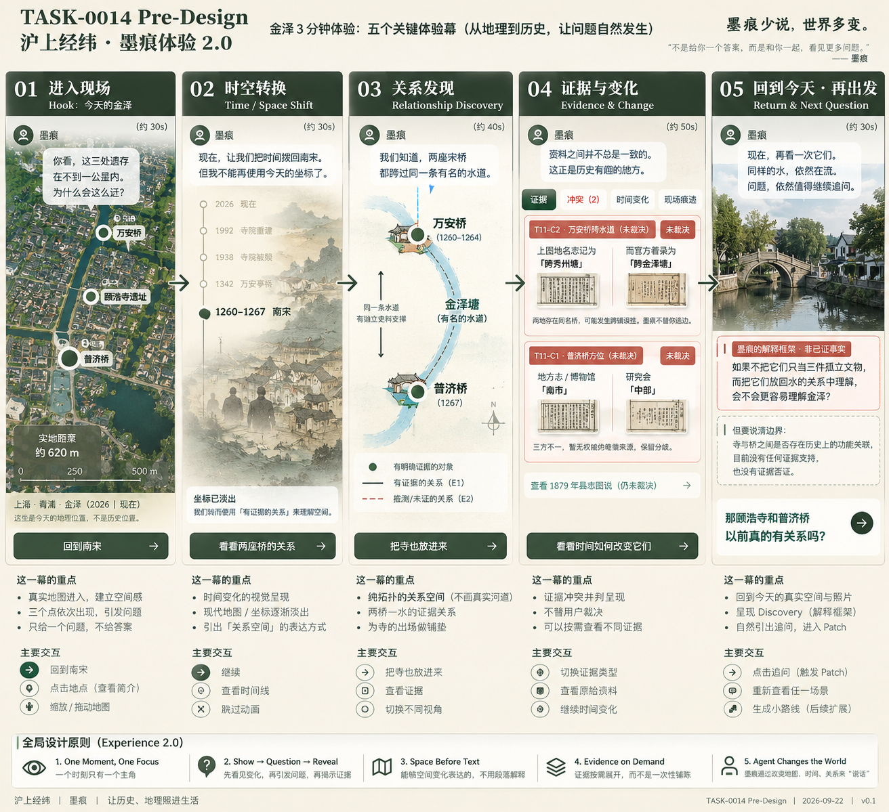
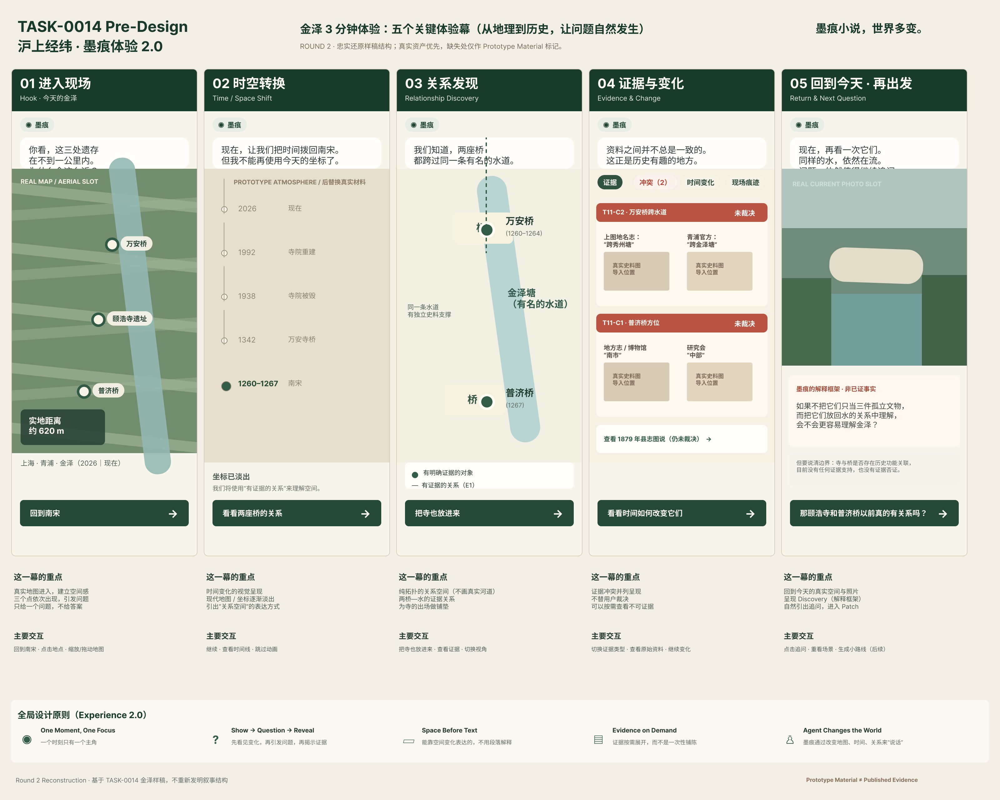
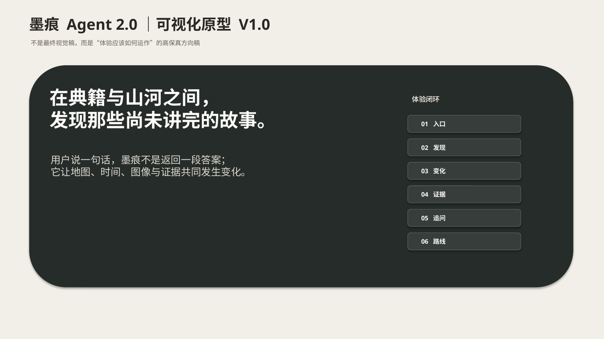
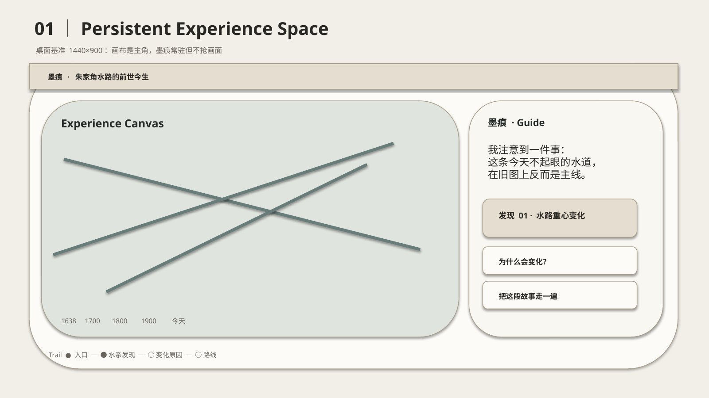
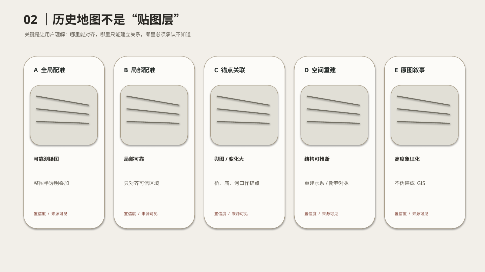
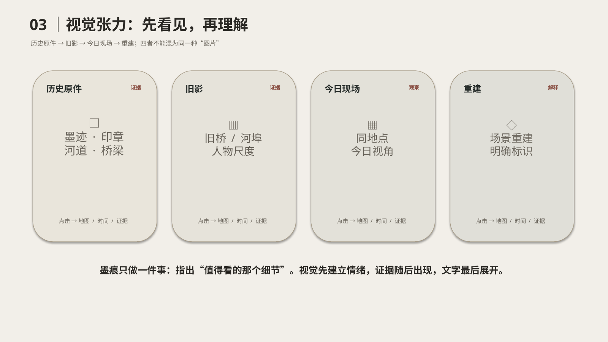
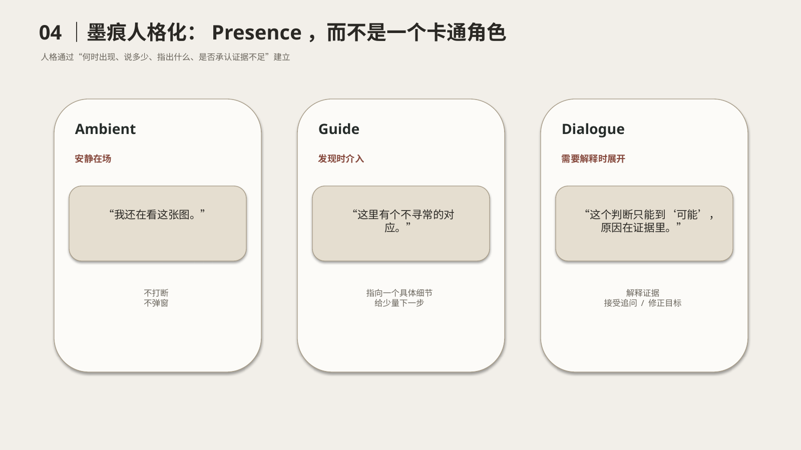
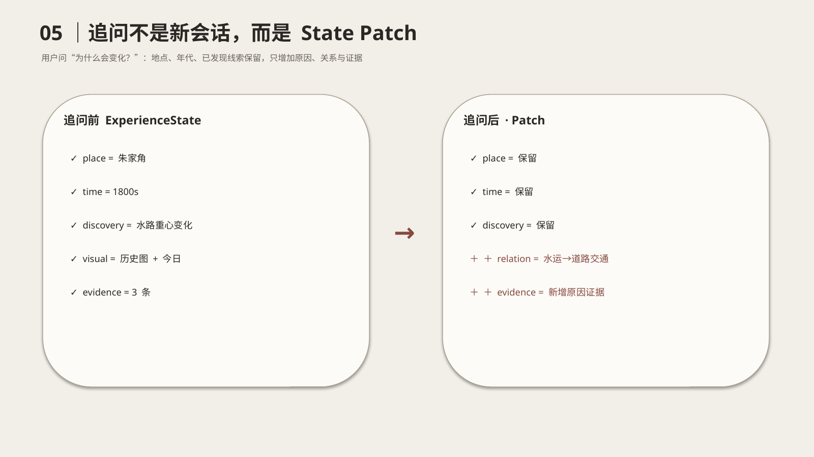
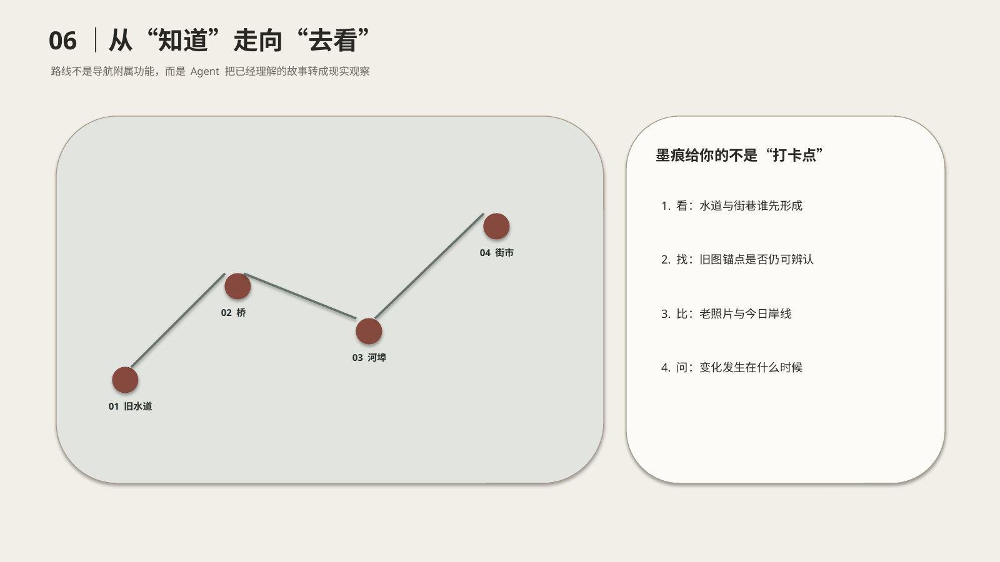
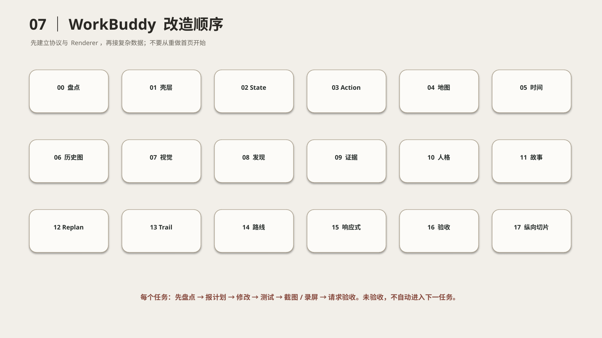

**MOHEN · C4 EXPERIENCE CONSTITUTION**

Agent-native Human Experience & UI Architecture V2.1

**墨痕人类体验与 UI 完整架构稿 · 定向修订版**

|                                                                                                                                                               |
| ------------------------------------------------------------------------------------------------------------------------------------------------------------- |
| 本版不是新增第四套 UI 文档，而是一次“收海归一”：将《Agent Experience & UI 交互设计 V1.0》《UI 设计规格 V1.0》《可视化原型 V1.0》的成熟内容尽可能吸收进 C4，并继续以金泽 Canonical Experience / Visual Baseline 作为不可退化底线。 |

C4 是体验与 UI 的主入口；具体施工结合现行双组件逐帧规范，人文问题与证据组织结合母题方法框架。Canonical 保留体验质量基线，不固定旧问题或旧物理布局。  
2026-09-28

# 0｜这份 C4 现在解决什么

过去几轮并不是重复劳动，而是在不同层级把同一件事逐渐说清楚：交互设计回答“用户怎样与 Agent 共处”；UI 规格回答“界面具体怎样组织”；可视化原型回答“这些原则在画面里大致是什么样”；Canonical 金泽样稿回答“真正达到什么体验质量才算成立”。本版把四层合并为一套长期 C4。

V2.1 定向吸收 V0.9.1：两个一级承载区、统一控制入口、用户布局选择保持、状态维度分离和移动端上方墨痕。七条体验语法、证据诚实、真实 Agent 边界及 Human Experience Gate 不降低。五个母题先作通用方法深化，具体场景通过材料盘点确定可用问题，不预先锁定金泽主母题。

| **来源**                          | **最强价值**                                                      | **在本版中的位置**                     |
| ------------------------------- | ------------------------------------------------------------- | ------------------------------- |
| Agent Experience & UI 交互设计 V1.0 | 完整交互逻辑、Screen 00–13、State/Action、Agent Proposal、用户行为回流、失败态与验收 | Part II 交互系统                    |
| UI 设计规格 V1.0                    | 桌面布局比例、S00–S08、历史地图五模式、图像五层、Presence、响应式、动效                   | Part III 界面规格                   |
| 可视化原型 V1.0                      | 把抽象规则变成 8 张可观看的方向图                                            | Part IV 原型图谱（嵌图）                |
| 金泽 Canonical 两张基线图              | 真实体验语法 + 视觉构成的最低质量                                            | Part I Non-Regression Authority |

|                                                                                                                       |
| --------------------------------------------------------------------------------------------------------------------- |
| 以后不再要求 开发总工程师 在文档海洋里自行拼图。C4 是 Human-facing Experience/UI 的主入口；旧文件保留为 Source Archive / Trace，不再与 C4 竞争日常 Authority。 |

# PART I｜C4 Constitution：体验不可退化的根原则

## 1｜墨痕 UI 到底是什么

墨痕 UI 不是让用户操作一个历史网站，也不是把聊天机器人贴在地图旁边。它是人进入一个活的人文世界，并在 Agent 引导下重新看见地方、时间、文化关系与当下生活的体验空间。C4 服务于 C1 的第一层人本北极星：从历史文化中重新发现当下生活的意义、乐趣、文化根源与个人共鸣；Agent-native 是当前实现这一价值的核心产品架构，而不是价值本身。

|                                         |
| --------------------------------------- |
| 不要让用户“看见 Agent 在思考”，而要让用户“看见世界正在被重新组织”。 |

Humanistic Data OS 让可信文化世界能够存在；Agent 判断此刻什么值得发现；Experience Architecture 把判断转成地图、时间、图像、关系、证据、叙事与行动的变化。UI 是整条链路在人面前的表达，而不是内部系统结构的可视化。

## 2｜Canonical Non-Regression Rule

|                                                                                  |
| -------------------------------------------------------------------------------- |
| 未来 UI 可以演进、扩展和超越，但不得在体验质量、视觉层级、认知节奏、空间优先、证据诚实、连续性、“回到今天”和行动性上退化到 Canonical 基线以下。 |

| **维度**   | **最低要求**                           |
| -------- | ---------------------------------- |
| 认知节奏     | One Moment, One Focus              |
| 推进方式     | Show → Question → Reveal           |
| 视觉层级     | Space Before Text；强视觉/真实空间先于解释     |
| 证据关系     | Evidence on Demand；可追溯但不抢主角        |
| Agent 表达 | Agent Changes the World；智能通过世界变化显形 |
| 连续性      | Patch-not-Replace；追问让同一世界继续展开      |
| 诚实性      | 事实 / 推断 / 类比 / 重建 / 未知必须分层         |
| 当下连接     | 历史最终重新落回今天的地方与生活                   |
| 行动性      | 自然产生继续看、走、比较、读、问、参与的欲望             |

Canonical Experience Grammar｜金泽历史关系探索体验板：五幕认知节奏是体验基线，不是五个固定页面。

Canonical Visual Composition｜EXP-DESIGN-02 Round 2：视觉层级与构成基线，不是逐像素模板。

Canonical 约束认知节奏、视觉层级、连续性、证据诚实和回到今天，不要求永久复用“620 米”开场、特定对象或底部 Sheet。历史原型中与本版现行物理布局冲突的部分，以第 5、8、14、18 节为准；时间、冲突比较与理解转折仍需深化并验证。

## 3｜Agent-native Experience Architecture

动态的是 Experience Composition，不是任意 UI generation。Agent 选择语义目标与 ExperienceAction；ExperienceState 保存当前体验；CompositionState 决定 Primary / Secondary / Context；Renderer 只使用注册过、受约束的 Surface。

物理界面只有视觉舞台与墨痕叙事两个一级组件。Canvas、Timeline、Trail、Evidence、Proposal 等是体验职责或受约束的内容表达能力，不必各占一个常驻区域。CompositionState 可以改变主角、镜头、材料与构图，但不能据此改变用户选择的分区或悬浮方式。

| **层**              | **职责**                     | **默认是否对用户可见** |
| ------------------ | -------------------------- | ------------- |
| Agent Judgment     | 理解 Goal、选择下一步、Replan       | 通过结果显形，不显示思考链 |
| ExperienceState    | 保存当前地点、时间、发现、证据、叙事、路线与上下文  | 否             |
| ExperienceAction   | 描述语义变化：聚焦、比较、揭示、Patch、提议等  | 否             |
| CompositionState   | 决定谁是当前主角、辅助与背景             | 否             |
| Surface / Renderer | 地图、时间、图像、关系、叙事、证据、路线       | 是             |
| Mohen Presence     | Ambient / Guide / Dialogue | 是，但不是永驻聊天框    |

用户应该感觉自己一直处于同一个不断展开的人文空间。页面只是容器，ExperienceState 才是当前体验。

## 4｜七条核心体验语法

### One Moment, One Focus

一次只让一个主要认知变化成为主角。

### Show → Question → Reveal

先看见异常、痕迹、距离或变化，再产生问题，最后揭示关系与证据。

### Space Before Text

地图、现场、原件、旧影、时间变化能表达的，不先写成长文。

### Evidence on Demand

任何关键结论可追溯，但 Evidence 默认在第二层。

### Agent Changes the World

Agent 的存在感来自空间与材料的变化，而不是说话数量。

### Patch-not-Replace

追问在原世界上增量变化；只有目标彻底改变才 Replace。

### Return to Present

过去必须重新改变用户看今天的方式。

# PART II｜完整交互系统：从一句话到现实行动

## 5｜Persistent Experience Space：长期存在与动态变化

| 长期保留的能力        | 动态变化的内容                 |
| -------------- | ----------------------- |
| 双组件体验容器与统一控制入口 | 墨痕内容和视觉舞台构图；用户选择的布局保持   |
| 视觉舞台           | 地图、原件、影像、对象、关系与发现       |
| 时间与证据职责        | 当前时期、变化点、有效期及判断对应来源     |
| 探索轨迹与分支返回能力    | 已探索节点、分支、语义快照与回退        |
| 墨痕输入与引导能力      | 目标、叙事、依据、Proposal 与现实观察 |

|                                                                                                           |
| --------------------------------------------------------------------------------------------------------- |
| Persistent Shell 保持的是体验容器与连续上下文，不是冻结舞台内容。用户控制显隐、停靠方式与尺寸；Agent 在这些选择内组织内容、焦点、镜头与叙事。推进、追问和历史回退不得覆盖用户最新布局选择。 |

## 6｜Screen 00–13：完整交互状态

| **Screen**    | **用户体验**                      | **关键交互 / 系统行为**                              |
| ------------- | ----------------------------- | -------------------------------------------- |
| S00 入口        | 大画布先于功能菜单；从一句自然语言、地点或当前位置开始   | 输入形成 Goal；不要求先理解栏目                           |
| S01 理解        | 墨痕用短句确认“准备从哪里找”               | 地点/年代/主题可修正；不显示思考链                           |
| S02 接管空间      | 舞台聚焦相关地点，时间内容进入相关范围           | 地点与时间理解通过舞台变化显形；不新增舞台工具条                     |
| S03 Discovery | 发现直接落在地图/时间/图像中               | 卡片只解释；Discovery 必须可验证                        |
| S04 进入发现      | 地图与时间共同变化                     | 关系线、变化区域、关键对象成为焦点                            |
| S05 时间镜头      | 时间不是筛选器，而是叙事镜头                | 变化点触发局部 Patch，不整屏刷新                          |
| S06 历史地图      | 根据证据质量选择五种表达模式                | 不得为了效果强行全局配准                                 |
| S07 Story     | 故事在双组件内部推进，不另开文章详情页           | 3–5 Beat 是认知节拍；可拆为多帧，舞台与墨痕同步                 |
| S08 追问        | 用户问“为什么？”时原场景保留               | place/time/discovery 保留，只补原因/关系/证据           |
| S09 Replan    | 沿当前世界继续推理                     | 优先 experience.patch；必要才 replace              |
| S10 更有意思的？    | Agent 不机械重复推荐                 | 根据已探索、未解决问题、novelty 重排发现                     |
| S11 Evidence  | 证据是当前判断的支撑，不是参考资料页            | 墨痕内按需呈现当前判断的来源、原文位置、年代及支持范围；原件细读进入舞台，不强制外加抽屉 |
| S12 把故事走一遍    | 已理解的 Story 转成 Spatial Anchors | Route 由已证实锚点组成                               |
| S13 现实行动      | 现场继续看历史、观察痕迹、完成任务             | Agent 从“告诉历史”变为“陪你在现实中继续探索”                  |

## 7｜Agent 的智能必须显形

| **Agent 能力** | **用户应该看到**            |
| ------------ | --------------------- |
| 理解地点         | 地图自动聚焦                |
| 理解时间         | 时间轴进入相关年代             |
| 理解目标         | 自动选择合适的体验构成           |
| 发现关系         | 关系线 / 空间并置 / 对比浮现     |
| 找到证据         | 原件、文献、旧影或来源入口出现       |
| 形成故事         | Narrative Beat 进入当前空间 |
| 判断下一步        | 少量有意义的 Agent Proposal |
| Replan       | 追问后原空间继续变化            |
| 记住探索         | Trail 与上下文保留，不重复从零开始  |
| 转向行动         | 把已理解内容转成路线与观察任务       |

|                                                   |
| ------------------------------------------------- |
| 如果 Agent 调用了很多工具，但屏幕没有发生有意义的变化，用户不会感受到 Agent 的能力。 |

## 8｜Mohen Presence 行为角色与可见状态

| 行为角色     | **用户看到**                  | **语言与行为**             | **禁止**       |
| -------- | ------------------------- | --------------------- | ------------ |
| Ambient  | 克制在场；可处于隐身或轻提示，不强制固定墨点位置  | 少说；观察；不打断             | 持续弹话、拟人动画抢画面 |
| Guide    | 指出一个具体视觉细节；可轻提示或在已展开墨痕内引导 | “这里有个不寻常的对应……”；给少量下一步 | 空泛赞叹、长篇解释    |
| Dialogue | 在墨痕内承载追问和澄清；展开时也不强制长对话    | 说明证据、判断、限制；接受修正目标     | 把所有体验收缩成聊天窗口 |

人格通过“何时出现、说多少、指出什么、是否承认证据不足”建立，而不是通过 Avatar。核心气质：好奇、克制、可靠，像一个从故纸与地方痕迹中发现线索的同行者。

状态分为五个维度：行为角色 Ambient／Guide／Dialogue；可见状态隐身／轻提示／展开；停靠方式分区／悬浮；用户调整的尺寸与位置；内容模式叙事／对话／依据等。行为角色与可见状态可关联但不等同；深读属于内容深入或舞台原件细读，不增加第四种在场态。切换内容不能隐式切换停靠方式。

## 9｜Agent Proposal：下一步不是固定菜单

下一步应根据 Current Goal + ExperienceState + 已探索内容 + 未解决问题 + Discovery + 可用工具动态产生。它的任务是延续好奇心，而不是展示产品功能。

| **当前阶段** | **有意义的 Proposal 示例** |
| -------- | -------------------- |
| 刚进入      | 看看这里以前是什么            |
| 看过历史空间   | 为什么会变化？              |
| 看过变化     | 找一个与变化有关的人           |
| 看过人物     | 看看他留下的文献             |
| 看过文献     | 把这条线走一遍              |
| 现场行动     | 找找旧图锚点今天还在不在         |

## 10｜ExperienceState → UI 映射

映射规则：体验语义与用户界面偏好分别管理。历史快照恢复地点、时期、发现、证据及分支，但保留用户最新的停靠、显隐与尺寸选择。该要求先映射现有状态结构，不以新增数据库对象或由 LLM 操作 DOM 实现。具体尺度变化导致的安全夹取见第 18 节。

| **State**                                                         | **UI 消费**                 |
| ----------------------------------------------------------------- | ------------------------- |
| goal / intent / place / period / theme / depth                    | 标题、Mohen Presence、当前目标    |
| focus / viewport                                                  | 地图镜头                      |
| map.layers / historicalLayers / registrationMode / anchors        | Map Renderer              |
| markers / relations / entities                                    | 对象、关系线、聚焦对象               |
| time.range / focusYear / changeEvents                             | Timeline Renderer         |
| visual.assets / activeAsset / correspondence / reconstructionFlag | Visual Renderer           |
| discovery.items / selectedId / evidenceStrength / novelty         | Discovery Surface         |
| narrative.beats / activeBeat / density                            | Narrative Surface         |
| evidence.sources / claims / confidence / provenance               | 墨痕内按需依据；原件细读由视觉舞台承载       |
| route.anchors / tasks / duration / uncertainty                    | Route Experience          |
| trail.nodes / branch / previousStates                             | Experience Trail          |
| nextActions / agentMessage / context                              | Agent Proposal / Presence |

## 11｜ExperienceAction → 用户可见行为

| **Action**                  | **用户看到**         |
| --------------------------- | ---------------- |
| map.focus                   | 镜头移动到地点          |
| map.showLayer / hideLayer   | 相关图层出现 / 退出      |
| map.compare                 | 古今或两地对照          |
| map.showRelation            | 关系线或空间关联出现       |
| time.set / time.compare     | 时间移动 / 时段对照      |
| image.show / image.compare  | 图像进入空间 / 与当前现场比较 |
| entity.focus / entity.open  | 聚焦或展开对象          |
| story.reveal / story.next   | 叙事层出现 / Beat 推进  |
| evidence.open               | 打开当前判断的来源        |
| route.propose / route.start | 形成路线 / 进入行动模式    |
| experience.patch            | 保留上下文的增量变化       |
| experience.replace          | 目标彻底变化后进入新体验     |
| agent.ask / agent.propose   | 请求必要输入 / 提出下一步   |

Agent 可以组合 Action，但不能生成任意前端代码，也不能绕过 Evidence Gate、Surface Eligibility 与 Experience Contract。

## 12｜UI 也要感知用户：Observe → Replan

UI 不只是 Renderer，也承担环境感知。停留、点击、关闭、跳过、追问、地图缩放、时间拖动、开始/结束路线等行为，都应进入 Context Update → Observe → Replan。

|                                                        |
| ------------------------------------------------------ |
| 真正的 Agent Experience 不是“系统向用户输出”，而是“用户与文化世界持续互相改变下一步”。 |

## 13｜不要把所有智能都卡片化

Card 只适合摘要、选择、证据入口和短解释。空间关系应由地图/关系构成表达；时间变化由时间镜头表达；视觉发现由原件/旧影/今日/重建表达；故事由 Beat 与空间同步表达。卡片不能成为万能容器。

# PART III｜界面设计规格：把交互原则变成可施工约束

## 14｜桌面骨架与区域比例

比例是现阶段默认建议，不是永久固定值。视觉舞台取消工具按钮；推进、回退、连续镜头等辅助操作在墨痕内按需组织，也可通过视觉对象直接触发。统一控制区应出现在真实用户界面中，不能只在工程审阅层可见。不得把移入墨痕的操作堆成常驻控制面板。

| 区域或职责            | 桌面规格             | 核心内容                 | 原则              |
| ---------------- | ---------------- | -------------------- | --------------- |
| 视觉舞台             | 横屏默认约 72% 可调整    | 地图、原件、图像、关系与时间变化     | 一级组件；承担主要视觉焦点   |
| 墨痕叙事             | 横屏默认约 28% 可调整或悬浮 | 目标、引导、叙事、依据、输入及下一步   | 一级组件；用户决定分区或悬浮  |
| 统一控制区            | 同一处可达入口          | 展开、收起、分区、悬浮；尺寸操作与其关联 | 不重复收起入口；隐身时仍可恢复 |
| Trail 与 Proposal | 墨痕内按需            | 探索节点、分支返回、有意义的下一步    | 保留能力，不额外常驻一栏    |
| Evidence 与时间职责   | 双组件内按上下文组织       | 具体判断来源、原件细读、时期与变化    | 不强制独立抽屉或常驻时间工具条 |

## 15｜历史地图 UI：把不确定性设计成能力

| **模式**                 | **视觉表现**     | **适用情况**        | **必须显示**       |
| ---------------------- | ------------ | --------------- | -------------- |
| Global Registration    | 整幅半透明叠加      | 测绘较可靠、控制点足够     | 配准误差 / 年代 / 来源 |
| Local Registration     | 局部窗口贴合现代地图   | 只有局部可可靠对应       | 有效范围边界         |
| Anchor Points          | 原图与现代图用锚点关联  | 道路水系变化大或舆图示意性强  | 锚点证据与置信度       |
| Spatial Reconstruction | 重建水系/街巷/桥梁对象 | 历史结构可推断但原图几何不可靠 | “重建”标签与依据      |
| Original-map Narrative | 保持原图，不强行叠加   | 高度象征化 / 非测绘舆图   | 方向/比例不可直接比较提示  |

时间承担时期切换、证据有效期和空间变化节点三种职责。时期、变化点和未知区间可作为画面内容出现；操作在墨痕内或通过可理解的视觉对象完成，不必恢复舞台 Slider 或工具条。重要变化点仅更新相关内容。舞台清净不能成为删除时间叙事的理由。

## 16｜图像视觉张力：先看见，再理解

| **视觉层** | **内容**       | **视觉策略**           | **证据策略**      |
| ------- | ------------ | ------------------ | ------------- |
| V1 历史原件 | 舆图、方志图、绘画、档案 | 大尺寸展示纸张纹理、题跋、印章、局部 | 原件即证据，显示出处与年代 |
| V2 历史影像 | 老照片、明信片、旧摄影  | 与地图锚点联动，可做过去/现在对照  | 拍摄时间与所表现年代分开  |
| V3 今日现场 | 现代摄影         | 尽量同视角或可比视角         | 明确为今日观察       |
| V4 解释标注 | 桥、河道、街巷、建筑轮廓 | 克制线框/热点，不覆盖原图主体    | 识别/人工/推断必须区分  |
| V5 重建想象 | AI/人工重建      | 可电影化转场，但始终明确“重建”   | 不得与史料图同级呈现    |

|                                                                         |
| ----------------------------------------------------------------------- |
| 默认视觉节奏：先给一张足够强的图像建立情绪 → 墨痕指出一个值得看的细节 → 用户点击后出现地图/时间对应 → 再给证据 → 最后才展开文字。 |

## 17｜CompositionState：视觉权重随目标变化

构图、空间模式与母题是三个不同层级。单景、对照、原件细读、关系观察、连续镜头组织视觉；第 15 节五模式依据空间证据选择；M1–M5 组织人文追问与理解进程。三者多对多组合，不按数量一一对应，不为每个母题新增一套一级界面。认知节拍、画面帧与物理页面分别描述。

| **当前目标** | **Primary**             | **Secondary** | **Context**        |
| -------- | ----------------------- | ------------- | ------------------ |
| 进入现场     | 真实地图 / 航拍 / 现场照片        | 墨痕一句问题        | 保留必要时期与材料身份；详细依据按需 |
| 时空转换     | 时间变化 + 历史视觉             | 现代地图淡出        | 短解释                |
| 关系发现     | 空间/对象关系                 | 关键对象标签        | Evidence 入口        |
| 证据核验     | 原始材料 / 冲突对照             | 当前关系          | 地图退背景              |
| 故事深入     | 关键图像 / Narrative Beat   | 地图与时间同步       | 证据脚注               |
| 回到今天     | 现实照片 / 当前地图             | 墨痕解释框架        | 历史证据退后             |
| 继续追问     | 新问题对应的新 Primary Surface | 旧发现保留上下文      | Trail / 回退         |

## 18｜响应式与动效

探索前进、回退、追问与母题变化不得自动改变用户停靠方式。设备旋转或视口变化时仅作必要的尺寸与位置夹取，保证内容和恢复入口可达，保持原模式与相对偏好，不以适配为由重置叙事。补验竖屏 390×844、短竖屏 390×667、软键盘、字体放大、键盘操作及浮层遮挡。直接点击视觉要素须有可感知的交互提示和替代操作。

| **场景**    | **规则**                                       |
| --------- | -------------------------------------------- |
| 桌面        | 1440×900 为第一验收基准                             |
| 平板        | 依据可用空间选择双组件方向；保留用户分区或悬浮偏好，不强制变为底部面板          |
| 手机        | 竖屏上方墨痕、下方舞台；另可选择悬浮。尺寸可调，避免机械等分；不采用默认底部 Sheet |
| 主视觉       | 任何时刻主屏只保留一个主视觉焦点                             |
| 年代切换      | 300–500ms 淡入 / 局部擦拭，只解释状态变化                  |
| Discovery | 定位脉冲一次，不持续炫技                                 |
| Replan    | 只高亮被 Patch 的区域                               |
| 依据呈现      | 墨痕依据与舞台原件联动，无炫技动画                            |
| 可访问性      | 必须支持减少动态效果                                   |

## 19｜事实 / 推断 / 类比 / 重建的视觉边界

四级表达必须固定，不允许靠文案含混过去。尤其是历史地图与 AI/人工重建：Geometry is a Claim；Visual Similarity is not Historical Fact。没有可靠坐标时，可以使用锚点、关系空间、局部配准、原图叙事，但不能伪造精确 GIS。

# PART IV｜可视化原型图谱：把抽象原则变成画面

以下八张原型保留为体验方向与历史视觉参考。它们说明能力与认知运动，不覆盖 V2.1 的双组件物理布局及用户控制权。图中的多区骨架、固定底部 Sheet、独立 Drawer 或绑定式三态，须按第 5、8、14、18 节解释，不逐像素照搬。

原型 00｜体验闭环：入口 → 发现 → 变化 → 证据 → 追问 → 路线。核心不是回答一段文字，而是让地图、时间、图像与证据共同变化。

原型 01｜Persistent Experience Space：保留画布主导与 Trail 职责；物理承载按第 5、14 节双组件规则。

原型 02｜历史地图不是“贴图层”：全局配准、局部配准、锚点关联、空间重建、原图叙事五种模式。

原型 03｜视觉张力：历史原件 → 旧影 → 今日现场 → 重建；四者必须有不同证据身份。

原型 04｜Presence：保留 Ambient／Guide／Dialogue 的行为角色；可见状态、停靠方式和内容模式按第 8 节分别处理。

原型 05｜State Patch：地点、年代、发现按语义增量变化；历史回退保留用户最新界面偏好，不把旧布局一起恢复。

原型 06｜从“知道”走向“去看”：路线把已经理解的故事转成现实观察，而不是旅游打卡点。

原型 07｜历史改造顺序：保留其组件分解价值；具体施工治理已被新的开发治理宪法取代，不再作为当前任务流程。

# PART V｜体验闭环、失败态与验收

## 20｜五类核心体验场景

| **场景**     | **要证明什么**                     |
| ---------- | ----------------------------- |
| T01 从地点开始  | 一句“这里以前是什么？”能进入时空探索           |
| T02 从关系开始  | Agent 能发现并解释值得看的文化关系，而不是列 POI |
| T03 从材料开始  | 典籍/旧图/老照片能反向连接地点、人物、事件与今天     |
| T04 从追问开始  | 为什么、还有吗、换个角度等追问让同一世界继续展开      |
| T05 从理解到行动 | 已理解的历史能转成现实观察、路线、比较或继续研究      |

## 21｜失败状态也是体验的一部分

| **失败/不确定**     | **正确体验**                                   |
| -------------- | ------------------------------------------ |
| 没有足够证据         | 明确说“目前只能到这里”，并给出可继续寻找的方向                   |
| 历史地图无法可靠配准     | 切换 Anchor / Original-map Narrative，而不是伪装精确 |
| 两个来源冲突         | 把冲突本身变成值得理解的线索                             |
| 找不到新 Discovery | 不硬凑“惊喜”；回到未解决问题或换比较尺度                      |
| 用户跳过某条线        | 记录行为，减少重复推荐                                |
| 目标彻底改变         | Replace 新 Experience；保留 Trail 供回退          |
| 现场锚点不确定        | 路线不把推测点包装成确定地点                             |

## 22｜Human Experience Gate

文稿完成、示意原型完成、真实体验通过分别记录。29 张施工页和 58 个横竖屏视图不代表完整体验闭环已通过。五母题方法可先完成通用深化，真实历史解释仍须证据成立；按五个吸引力测试检验好奇、展开、人的生活、理解变化与当下连接，不能以功能覆盖代替。

| **Gate**                 | **核心问题**                    | **FAIL 信号**          |
| ------------------------ | --------------------------- | -------------------- |
| P1 重新看见                  | 体验后是否重新看见今天的地方/桥/河/街道/生活？   | 只记住知识点               |
| P2 与我有关                  | 是否理解为什么这段过去与今天的自己有关？        | 像看百科/说明牌             |
| P3 继续行动                  | 是否想继续观察、走、比较、问、读或参与？        | 看完即结束                |
| Visual Focus             | 是否一眼知道当前主角？                 | 地图、卡片、Evidence 同时抢焦点 |
| Agent Presence           | 是否感到墨痕在推动世界变化？              | 只有聊天文字变化             |
| Evidence Honesty         | 不确定性是否诚实但不喧宾夺主？             | 要么隐藏，要么技术面板统治页面      |
| Canonical Non-Regression | 是否至少达到两张 Canonical 基线的体验质量？ | 工程更复杂但体验更弱           |

|                                 |
| ------------------------------- |
| 核心 Human Gate：这段过去有没有让用户重新看见今天？ |

## 23｜最终 10 项判断

  - 用户能否不用理解网站栏目就开始探索？

  - 一句话能否成为 Agent Goal？

  - Agent 能否改变地图？

  - Agent 能否改变时间？

  - Agent 能否产生可验证的 Discovery？

  - 用户追问后空间是否连续？

  - 系统是否根据已探索内容避免机械重复？

  - Agent 是否能提出真正有意义的下一步？

  - 故事是否能转化为现实观察或行动？

  - 如果删除聊天窗口，Agent 是否仍然存在？

|                                          |
| ---------------------------------------- |
| 前九项成立，第十项也成立，才可以说 Agent Experience 真正成立。 |

## 24｜我们已经犯过的错：永久反模式

| **反模式**                 | **为什么错**           | **C4 防线**                   |
| ----------------------- | ------------------ | --------------------------- |
| Debugger / Dashboard 化  | 用户看到工程而非文化世界       | Human-facing Surface 独立验收   |
| Evidence Browser 成主角    | 可信性压倒发现与意义         | Evidence on Demand          |
| Card Stack / Text First | 实现快但空间/图像/时间失去主角   | Space Before Text           |
| 坐标网格第一视觉                | 地点被抽象成技术对象         | 真实现场先于坐标                    |
| 网页导航夺权                  | Agent 重新变成附属功能     | Persistent Experience Space |
| 假 Agent                 | 能演示流程但不会真正发现/判断    | 区分体验壳与真实 Agent 能力           |
| 过度 Figma 化              | 视觉稿制造虚假进展          | Figma 只解决关键视觉问题             |
| 工程 PASS = 体验 PASS       | 系统正确但仍然无趣          | Human Gate 独立               |
| 没看真实运行态就 PASS           | 文字 Result 不能代表用户所见 | 截图/录屏是 Human 验收必需           |
| 五幕 = 五页面                | 破坏连续状态             | 五幕是认知循环                     |
| AI 图填历史缺口               | 气氛被误当事实            | 重建必须明确标识                    |

# PART VI｜施工治理与文档归位

## 25｜开发总工程师的 UI 硬边界

  - 禁止重新做一套独立 Agent UI；

  - 禁止把 Agent 固定成右下角聊天框；

  - 禁止前端组件自行决定 Agent Goal；

  - 禁止把每个 Agent Action 都做成页面跳转；

  - 禁止把 Discovery 全部做成 Card List；

  - 禁止 LLM 直接操作 DOM / React；

  - 禁止为了“AI感”增加无意义动画；

  - 禁止没有真实 Evidence 时制造视觉化历史故事；

  - 禁止每轮对话重新初始化 ExperienceState；

  - 优先 Patch，只有目标彻底变化才 Replace；

  - 任何 Human-facing 改动必须做 Canonical Non-Regression 检查。

禁止叙事推进、追问、母题切换或旧快照覆盖用户当前布局；禁止重复设置收起入口；禁止将辅助工具重新铺满视觉舞台；禁止把五母题误做成五套固定页面或固定答案。

## 26｜新的施工方式：放松流程，不放松边界

旧原型中的 开发总工程师 改造顺序保留为历史实现参考，但不再要求每次 UI 调整都走 Task Book → Result → Architect Sign-off。当前开发模式下，用户直接用自然语言和 开发总工程师 施工；开发总工程师 读取 C0、CURRENT、C4 与必要的 C1/C2/C3 后自行完成局部工程判断。

只有当改动会降低 Canonical、改变 Experience Contract / Evidence 表达 / Agent 能力边界，或需要新数据库核心对象/新基础 Surface 时，才提交项目拥有者确认做 Architecture Reconciliation。普通视觉、交互、组件与 Bug 修复由开发平台自主完成。

## 27｜旧文件最终归位

| **资产**                                           | V2.1 定向修订后定位                                                                                                  |
| ------------------------------------------------ | ------------------------------------------------------------------------------------------------------------- |
| C4 当前修订版                                         | C4 PROFESSIONAL AUTHORITY：Human-facing Experience / UI / Surface / Renderer 的完整宪法；受 C1 Final Vision 与长期冻结原则统领 |
| MOHEN\_EXPERIENCE\_UI\_BASELINE\_V1.0            | IMPLEMENTATION QUICK REFERENCE / TRACE：成熟规则已吸收进 C4；Canonical Non-Regression 继续有效                              |
| 金泽历史关系探索体验板.png                                  | CANONICAL EXPERIENCE GRAMMAR · 永久保留                                                                           |
| EXP-DESIGN-02 Round 2                            | CANONICAL VISUAL COMPOSITION · 永久保留                                                                           |
| Agent Experience & UI 交互设计 V1.0                  | SOURCE ARCHIVE / TRACE；成熟内容已吸收                                                                                |
| UI 设计规格 V1.0                                     | SOURCE ARCHIVE / TRACE；成熟内容已吸收                                                                                |
| 可视化原型 V1.0.pptx                                  | SOURCE ARCHIVE / VISUAL TRACE；核心 8 页已嵌入 C4                                                                    |
| Agent Experience UI 原型设计 V1.0                    | SOURCE ARCHIVE；可作为更细工程原型参考                                                                                    |
| 旧 UI 开发任务包                               | HISTORICAL CONSTRUCTION SOURCE                                                                                |
| Legacy M5 Human Fail / UI Audit / Reconstruction | FAILURE & VALIDATION EVIDENCE · 永久保留；M5 仅为历史阶段标签，不再作为当前 C1 进度术语                                               |

|                                                                  |
| ---------------------------------------------------------------- |
| 目标不是删除历史，而是让日常执行只面对少量真正有 Authority 的文件。旧文件留作追溯，不再要求执行者逐份阅读后自行综合。 |

## 28｜C4 的一句话最终定义

|                                                                                                                        |
| ---------------------------------------------------------------------------------------------------------------------- |
| 墨痕 UI 不是把历史资料展示得更完整，而是让一个可信的文化世界在人的眼前有意义地发生变化；Agent 通过地图、时间、图像、关系、证据、叙事与行动组织这种变化；金泽 Canonical 已经定义最低体验质量，未来只能在此之上继续生长。 |

如果去掉聊天框、调试器和架构解释，墨痕仍然应该存在：用户说了一句话，眼前的世界发生了有意义的变化，而且它知道下一步带用户去哪里。

# 附录｜本版吸收范围

本版重点吸收三份历史文件中已经成熟且仍适用于长期墨痕的内容；对于已被新治理取代的“逐任务施工流程”等内容，保留其历史价值但不继续提升为当前 Authority。

  - 《Agent Experience & UI 交互设计 V1.0》：从网站+AI到 Agent Experience Space；Screen 00–13；Persistent Shell；Agent 智能显形；Ambient/Guide/Dialogue；Agent Proposal；ExperienceState / ExperienceAction；用户行为回流；路线与现实行动；失败态；最终 10 项判断。

  - 《UI 设计规格 V1.0》：桌面区域比例；S00–S08；历史地图五模式；时间轴职责；图像五层；Presence 语言/禁止项；ExperienceState 最小字段；响应式；动效；核心验收脚本。

  - 《可视化原型 V1.0》：体验闭环、Persistent Experience Space、历史地图五模式、视觉张力、Presence、State Patch、从知道到去看、历史改造顺序的 8 页原型图。

  - Canonical 金泽两张基线：继续作为不可退化的体验与视觉底线。

V0.9.1 双组件逐帧规范：吸收已确认的物理承载和交互规则；当前示意不替代真实材料和 Agent 验证。母题框架 V1.3：负责五母题的方法、研究与证据条件；C4 负责其体验表达与边界。

# 附录 V2.1 定向变更说明

| **章节**     | **定向修订**            | **保留与后续验证**                     |
| ---------- | ------------------- | ------------------------------- |
| 3、5、14     | 双组件承载与统一控制入口        | 时间、Evidence、Trail、Proposal 能力保留 |
| 6、8、10     | 行为与可见状态分离；依据不固定为抽屉  | Goal、State、Action 语义边界保留        |
| 14、18      | 用户布局优先；手机上方墨痕；可调尺寸  | 默认比例、软键盘与遮挡待实机校准                |
| 15、17      | 时间继续可见；构图、空间模式、母题分层 | 五母题按证据组织，不固定剧情                  |
| 2、19、22、25 | 明确旧图适用边界与新增防误读规则    | Canonical、证据诚实、Human Gate 不降低   |

本版修改架构文字与章节点规则，未宣称现有代码已实现这些能力。后续逐帧规范、原型与执行任务应按这些条款同步核对。
