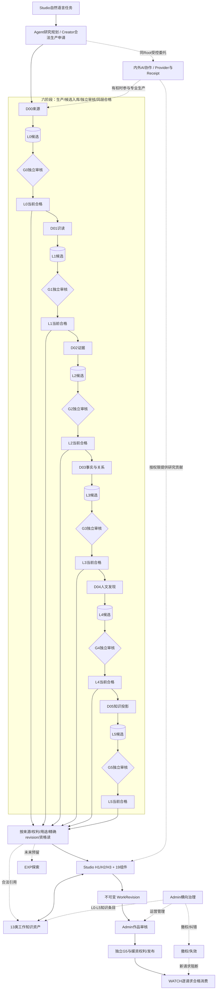

# 墨痕 M5 全链路导航｜持续维护基线（非权威标准）

> 源码核对基线：`xiezuojie03-web/mohen-agent-2.0@2c4db01783ccdb24d21f1fc99e1b28abca82d3fc`；核查日期 2026-11-15。唯一施工与准出标准仍为 `tasks/implementation/MAB/PLAN.md` V1.7 §3.5 B/C。每次施工必须先回读 `CURRENT.md` 与最新 main、CI/实际运行证据。
>
> **角色：** 本图为后续任务的“指南针”，可以在阶段性定向收口后持续生长。不是系统已跑通的证明，不构成第二套架构权威、Runner、Gate、知识库或M5验收标准。三份导航（JSON/MD/HTML）必须同步更新。

## 分模块展开与完整统计（沿用37节点/54连接）

导航把现有对象划成9个互斥主归属领域（`nodes[].primary_domain`、`edges[].primary_domain`），保持原37节点和54条结构连接不变。D00—D05继续显示完整六段主链；其它领域在HTML中可展开为有输入、责任与验收检查的业务步骤。**这些步骤是核查说明，不是新的节点、代码或已通过测试。**

### 全图与当前M5统计分母

- 全图：**37节点、54连接**；其中M5当前范围**36节点、52连接**，EXP未来**1节点、2连接**。
- 54条连接已定向诊断7条，尚未完成定向接口归因45条，另2条未来预留。当前M5连接的定向诊断覆盖为 **7/52 = 13.5%**，未定向核查 **45/52 = 86.5%**；此处是**诊断证据覆盖率**，不是工程实现或完成率。
- M5运行层 **0/52条连接具备本导航可认可的同Root PASS证据**，不等于52条连接全部没有代码。
- 下表节点与连接采用互斥主归属，可相加；M5八维是交叉映射，**一个连接可对应多个维度，八维列不可相加**。

### 三层状态完整统计（当前M5，排除EXP未来边）

| 对象与层次 | PASS | PARTIAL | HOLD | NOT_VERIFIED | 分母 |
|---|---:|---:|---:|---:|---:|
| 连接 ◆能力 | 0 | 7 | 0 | 45 | 52 |
| 连接 ⇄连接 | 0 | 3 | 4 | 45 | 52 |
| 连接 ●运行 | 0 | 0 | 0 | 52 | 52 |
| 节点 ◆能力 | 0 | 36 | 0 | 0 | 36 |
| 节点 ⇄连接 | 0 | 2 | 3 | 31 | 36 |
| 节点 ●运行 | 0 | 0 | 0 | 36 | 36 |

全图另有1个EXP未来节点、2条未来连接，三层状态均为FUTURE。每行按自己的分母算比例，例如连接能力PARTIAL为**13.5%**、连接能力NOT_VERIFIED为**86.5%**，不能用未核实比例推断开发缺失。

### 专业合同细目与工程状态的界线

- **13类知识工作资产**：`research_brief / source_anchor / reading_note / evidence_note / spacetime_candidate / relation_hypothesis / humanistic_insight / research_collection / director_plan / media_selection / work_revision / citation_snapshot / consented_feedback`（来源：`specs/KNOWLEDGE_ASSET_LIFECYCLE_CONTRACT.md` §10）。均是受控的合同目标，现阶段不能用清单存在推断全部实现。
- **19组件**：W01 作品导航；W02 视觉舞台容器；W03 时间节拍轴；W04 历史空间承载；W05 原件阅读与导读；W06 对照与比较；W07 关系观察；W08 叙事字幕与声音；W09 墨痕在场；W10 证据与出处返查；W11 镜头调度与播放；X01 探索意图与路径；X02 探索快照与返回；C01 资产检索选择器；C02 AI 编排建议比较；C03 节拍与镜头编辑器；C04 预览和版本管理；C05 资格与导出发布；F01 缺口工单与回流（来源：`specs/experience-ui/H1_H2_H3_AND_COMPONENTS_CONTRACT.md` §4.1）。其中W族11项、X族2项、C族5项、F族1项，跨WATCH/EXP/Studio/回流，不全属于Studio页面。
- HTML在对应模块中提供可展开的**合同目录**，仅帮助后续逐项核查，**不改变37节点/54连接与M5八维准出分母**。

### 模块结构分布（互斥主归属）

| 业务领域 | 节点 | 连接 | 占全部54条 |
|---|---:|---:|---:|
| Studio入口与研究委托 | 2 | 2 | 3.7% |
| D00—D05六阶段生产主链 | 24 | 23 | 42.6% |
| 内外AI混合协作 | 1 | 3 | 5.6% |
| L0—L5合格知识复用 | 1 | 7 | 13% |
| 13类知识资产与复用生命周期 | 1 | 4 | 7.4% |
| Studio创作与作品修订 | 2 | 2 | 3.7% |
| Admin全层知识与运营治理 | 2 | 8 | 14.8% |
| 发布、WATCH与即时撤权 | 3 | 3 | 5.6% |
| EXP探索（未来预留） | 1 | 2 | 3.7% |
| **合计** | **37** | **54** | **100%** |

### M5八维交叉对应（非完成率）

| 维度 | 对应连接数 | 占52条M5连接的覆盖比例 |
|---|---:|---:|
| 1. 自然语言创作入口 | 2 | 3.8% |
| 2. 内外AI混合协作 | 3 | 5.8% |
| 3. 真实来源、证据和D/L/G生产 | 32 | 61.5% |
| 4. 13类知识资产沉淀 | 4 | 7.7% |
| 5. Studio真实创作 | 12 | 23.1% |
| 6. Admin知识资产管理 | 9 | 17.3% |
| 7. 独立G5、媒资权利与发布 | 3 | 5.8% |
| 8. WATCH同修订合法消费与撤权 | 3 | 5.8% |

**使用与持续维护**：查看HTML顶部“完整统计”模块，可在“节点/连接”以及“当前M5/全图”之间切换分母；下方可展开9个业务领域及10组内部业务链路，逐项查看输入/输出/权限和原54条连接。机器按`statistics`、`navigation_domains`读取，但**基础真相仍是`nodes[]/edges[].verification_layers`与精准证据**；每次更新必须重新计算校验统计，不能凭百分比改判PASS。

### 单张完整架构图原位展开（2026-11-16交互纠偏）

本轮根据Owner对导航的反馈，默认HTML界面改为**同一总体架构内展开模块**：入口与受托研究→正式D/L/G与知识/资产→创作/治理/发布与WATCH，账户身份横线贯穿所有工作面，EXP保留未来边界。点击任一模块就在其所在架构位置展开68步骤中的相关环节，点击局部交接就在该卡内查看上下游、许可、源码与三层状态，不再要求跳到页面下方另一组模块列表。

**仍只有一份工程事实**：原37节点、54条主连接及其verification_layers、统计与唯一M5八维验收不变；10组内部检查清单/58条未验交接也不变。HTML使用JSON顶层`ui_presentation`说明布局，依据`module_internal_chains`展示展开内容；这只是浏览器的**呈现与导航组织改进**，没有新增代码能力、运行回执或专业设计合同。

**浏览方式**：完整架构默认保持所有模块可见；各模块原位展开/收起，展开区可滚动，不把其他模块移到页面外；D00—D05模块展开后仍按六阶段候选→G审核→当前合格查看；交接按钮显示来源、输入输出和状态。顶部可一键收起全部或定位当前已知G0断点。完整统计及54条主连接台账作为主图下方的查证附录。可选/并行/条件分支仍非强制流水线。

## 导航完整性审计与分批核查—施工跟踪机制（2026-11-16）

**裁决**：按PLAN §3.5 B/C，采用**小批次相邻断点排查→证据归因→定向修复→同Root正反回归→导航同步**。不先全查52条才施工，也不因静态路径存在就直接开工。后续仍只有M5八维唯一准出，本节不是新阶段或第二施工计划。

**结构初审已完成的范围**：原主图37节点、54连接（当前M5 52条，EXP未来2条）无孤立节点、无无效端点；所有非生产主连接均可由新增10组内部业务链定位；GitHub main@31be2feacf3e的文件树共有2218条文件，30条唯一主图路径和34条唯一内部链路径均存在。**这些不是34个接口通过或58次直接调用**：58个内部交接仅是待核业务关系，存在并行、条件、跳转和可选通路。当前52条M5中7条已有根因诊断、45条未逐接口归因，整体仍无同Root M5 PASS。

**审计结论界限**：目前可以确认**结构覆盖及路径存在**，不能确认所有业务节点语义与实际代码拓扑完全一致。关键错误风险是把内链相邻检查顺序当强制调用、把历史static PARTIAL当运行PASS、把身份/成本支管推迟到发布后，以及把EXP/M7扩展误算M5。

| 互斥核查归档组（不是施工先后表） | 当前范围连接 | 已有定向归因 | 未归因 | 首先关注 | 触发时机 |
| --- | ---: | ---: | ---: | --- | --- |
| F01 Studio入口与G0独立资格 | 7 | 5 | 2 | E_D00_REVIEW、E_D00_QUALIFY | 同一Creator/Project/Root需要从D00候选进入D01 |
| F02 D01识读→G1→D02专业请求 | 9 | 2 | 7 | E_D01_REVIEW、E_D01_QUALIFY、E_L1_TO_D02 | 已能合法读取当前G0资格并取得真实D01候选 |
| F03 D03与D04知识生产邻接 | 10 | 0 | 10 | E_L2_TO_D03、E_L3_TO_D04 | D02/G2已有合法输出可供真实主张和人文解释 |
| F04 D05公开知识分面与G5 | 5 | 0 | 5 | E_L4_TO_D05、E_D05_QUALIFY | 上游已有当前适用资格且需要形成合法公开L5分面 |
| F05 Agent与外部Provider真实混合协作 | 3 | 0 | 3 | E_AGENT_TO_MIXED、E_MIXED_TO_D00 | 真实Root调用外部AI/Skill或G0修复需要其来源/费用前置 |
| F06 L0—L5研究读取及消费者资格 | 7 | 0 | 7 | E_REUSE_TO_STUDIO、E_L0_TO_CREATIVE、E_L1_TO_CREATIVE | Studio需要使用已合格知识或生产链首份合格L知识可以被消费 |
| F07 13类资产与Studio作品修订 | 6 | 0 | 6 | E_REUSE_TO_ASSETS、E_CREATIVE_TO_ASSETS、E_STUDIO_TO_REV | 真实研究产生需保存的资产或合法知识足以形成DirectorPlan/WorkRevision |
| F08 Admin运营、原子发布及WATCH撤权 | 5 | 0 | 5 | E_ADMIN_TO_EDITORIAL、E_EDITORIAL_TO_PUBLISH、E_PUBLISH_TO_WATCH | 同一WorkRevision由Creator提交并具备合法运营与G5/媒体前置 |
| FUTURE EXP未来探索接口（不计M5） | 2 | 0 | 0 | 后续授权 | 由后续授权交付正式设计并进入相应实施阶段 |

**施工工作量判断**：这里的54条主连接不是54个独立修复任务；7条已有定向诊断不得重复从零查，45条未归因也不能全部自动当代码缺口。核查投入按“同一真实任务最前断点的相邻接口+权限/资格/预算支管”分组，**每批优先2—5条最相关边**，同一Signer/Runner/Owner读模型可共用代码与回归证据；遇到接口错误当批修复，不在核查组全部结束前停工。D00/G0、L1→D02、后续专业D阶段、Agent/Provider费用、资产/Studio、运营与WATCH的实际工作强度依赖持久PG/HTTP/Storage/Provider/Reviewer能否使用，当前无法从静态文件数可靠换算工时或承诺整体交付时间。

**最前执行入口**：BATCH-02已在main@`501829ac1509`完成D00/C01阶段输出重构与既有Reviewer签发接口模拟正反；当前不再把问题表述为“缺stage_binding代码”。最前阻断已收敛为具名持久非生产PG环境未确认：须在该环境完成真实Reviewer签发、Runner同Root当前资格读取、错digest/错身份/撤权负例及恢复。环境未具备前保持具名HOLD，不启动G1/D02实跑；验证通过后再核`E_D01_REVIEW`/`E_D01_QUALIFY`与`E_L1_TO_D02`类型化输入。真实Provider、费用、项目权利属于随节点必须接入的支管，**不等F01—F04全部做完才处理**。

**导航首页覆盖率自动取数**：原总览中的7/52、45/52只代表本次审计时点。HTML总览、跟踪分组均改为从JSON根边即时派生，后续发生定向诊断变化不用再手工改旧数字；诊断覆盖率不是通过率。

**跟踪显示的唯一数据来源**：分组的“已定向归因”数量随`edges[].engineering_diagnosis`实时派生，不使用2026-11-16的7/52作为永久最新计数；`audit_tracking.baseline`只是本次结构审计的历史快照。判定PASS仍只读原`verification_layers`三层，而不是归因数量。

**每批成果如何同步**：先`CURRENT.md → PLAN §3.5 B/C → JSON audit_tracking.next_frontier → 原边三层状态 → 相关模块58细分候选`；只对新证据影响的边更新`engineering_diagnosis`和`verification_layers`、相关内部交接证据并重算`statistics`；JSON、MD、HTML在同一main提交同步校验，真实运行进度记录`CURRENT.md`，精确SHA/环境/Root/POS-NEG/恢复回执记录`progress.md`。有证据才改状态，无证据不改、不能把NOT_VERIFIED当失败。未来正式设计交付入仓时再单独评估对UI链路的影响。

## 2026-11-16｜M5-G0-BATCH-01：已修候选定位，G0资格仍HOLD

- **目标断点**：[`E_D00_REVIEW` 进入导航定位](M5_MAINLINE_NAVIGATION_20261115.html#edge-E_D00_REVIEW)（L0候选→G0独立审核）；[`E_D00_QUALIFY` 进入导航定位](M5_MAINLINE_NAVIGATION_20261115.html#edge-E_D00_QUALIFY)（G0→当前资格）。在下载的交互HTML中，以上锚点自动展开D00—D05模块并显示对应断点；页面顶部另有“本批G0”两个按钮。
- **本批完成**：`tools/local-gate-service.mjs`不再用固定样板`PROJECT_ID`；新增`tools/gate-stage-candidate-selection.mjs`严格匹配当前run/stage/Gate/input及SUBMITTED/producer，只接受唯一候选并从其数据库存储的项目范围建立Reviewer限制。防止混选候选和错用样板项目。
- **测试**：主CI [43797796219](https://github.com/xiezuojie03-web/mohen-agent-2.0/actions/runs/43797796219) **SUCCESS**，对应代码提交 [`718503e6f5ce`](https://github.com/xiezuojie03-web/mohen-agent-2.0/commit/718503e6f5ce9166a25628bcff437c2daab5ded1)，含4组新正反边界测试；这是CI/静态接口证据，非持久Owner-Reviewer-G0同Root正反验收。
- **未完成且不能伪绿**：现行独立审查对象级PASS记录尚未获得Reviewer独立核定的`stage_binding`；`E_D00_REVIEW`和`E_D00_QUALIFY`原能力PARTIAL、交接HOLD、运行NOT_VERIFIED保持不变。下一批解决可信stage输出→独立签署的真实同源证明，再做真实资格读取；仍不得以Producer请求output_digest补写PASS。
- **跟踪规则**：本批事实在JSON `audit_tracking.last_execution_batch`；详细时间、文件和证据在`tasks/implementation/MAB/progress.md`；工程状态在`CURRENT.md`。后续每批继续用**相同原根边ID、精确源码SHA和真实回执**回填导航；不新增工程阶段或Gate。

## 非D00—D05模块内部链路全分解（2026-11-16）

**本轮目标与依据**：本轮在模块职责与Agent讨论已截稿后，直接核对GitHub现存UI、专业合同、U07动作设计、M5 PLAN和源码。**不把资料库CEI研究原型当作现行工程设计**。原37节点、54条跨模块边（其中52条M5，2条EXP未来）、全部原验证三层状态、诊断覆盖和M5八维分母均保留。

新增加 **10组模块内部业务链**（含HOME/用户权限这两条横线），总计**68个可定位业务步骤、58个内部交接检查点**。它们不是58条新增的正式主图边，更不是58个新验收门；只解决原54条粗粒度业务连接内部“到底卡在哪一步”的问题。所有内部交接首次均为**NOT_VERIFIED**，源文件路径是核查入口，不等于完整功能存在，更不等于PASS。

| 内部业务链 | 归属/范围 | 业务步骤 | 细分交接 | 原主图关联 | HTML入口 |
| --- | --- | ---: | ---: | --- | --- |
| HOME入口与全局导航 | M5_ENTRY_ONLY | 5 | 4 | E00, E01 | [展开](M5_MAINLINE_NAVIGATION_20261115.html#module-intake) |
| 账户身份与权限横线 | M5_CROSSCUT_AUTH | 6 | 5 | E_ADMIN_L0, E_ADMIN_L1, E_ADMIN_L2, E_ADMIN_L3, E_ADMIN_L4, E_ADMIN_L5, E_ADMIN_TO_EDITORIAL, E_ADMIN_TO_REVOKE | [展开](M5_MAINLINE_NAVIGATION_20261115.html#module-admin) |
| Studio自然语言入口与正式生产请求 | M5_DIM_1 | 6 | 5 | E00, E01 | [展开](M5_MAINLINE_NAVIGATION_20261115.html#module-intake) |
| Agent与外部AI同Root协作 | M5_DIM_2 | 7 | 6 | E_AGENT_TO_MIXED, E_MIXED_TO_D00, E_MIXED_TO_CREATIVE | [展开](M5_MAINLINE_NAVIGATION_20261115.html#module-mixed) |
| L0—L5合法知识复用链 | M5_DIM_3_5 | 7 | 6 | E_L0_TO_CREATIVE, E_L1_TO_CREATIVE, E_L2_TO_CREATIVE, E_L3_TO_CREATIVE, E_L4_TO_CREATIVE, E_L5_TO_CREATIVE, E_REUSE_TO_STUDIO | [展开](M5_MAINLINE_NAVIGATION_20261115.html#module-knowledge_use) |
| 13类工作资产持久化和复用 | M5_DIM_4 | 8 | 7 | E_REUSE_TO_ASSETS, E_CREATIVE_TO_ASSETS, E_ASSETS_TO_CREATIVE, E_ASSETS_TO_ADMIN | [展开](M5_MAINLINE_NAVIGATION_20261115.html#module-assets) |
| Studio导演、作品修订及投稿 | M5_DIM_5 | 8 | 7 | E_STUDIO_TO_REV, E_REV_TO_EDITORIAL | [展开](M5_MAINLINE_NAVIGATION_20261115.html#module-studio) |
| Admin知识治理、运营和作品审核 | M5_DIM_6 | 8 | 7 | E_ADMIN_L0, E_ADMIN_L1, E_ADMIN_L2, E_ADMIN_L3, E_ADMIN_L4, E_ADMIN_L5, E_ADMIN_TO_EDITORIAL, E_ADMIN_TO_REVOKE | [展开](M5_MAINLINE_NAVIGATION_20261115.html#module-admin) |
| 发布→WATCH合法消费→撤权 | M5_DIM_7_8 | 8 | 7 | E_EDITORIAL_TO_PUBLISH, E_PUBLISH_TO_WATCH, E_REVOKE_TO_WATCH | [展开](M5_MAINLINE_NAVIGATION_20261115.html#module-publish) |
| EXP现有能力与未来深链 | FUTURE_NOT_M5 | 5 | 4 | E_REUSE_TO_EXP, E_WORKREV_TO_EXP | [展开](M5_MAINLINE_NAVIGATION_20261115.html#module-exp) |

**业务拓扑特别说明**：表中的68个步骤是**核查覆盖清单**，58个内部交接是**相邻业务依赖的候选检查点**，**不是每次用户任务必须串行走完的58道步骤，也尚未证明代码中存在对应的58次直接函数调用**。例如HOME的搜索与返回、Admin的资产审计与作品审核均可独立发生；Studio可合法复用已有L而不启动ST-04；Agent研究可按授权进入D00或创作；资产跨项目Fork归M7；撤权仅在相关事件发生后启动。内部关系初始全为NOT_VERIFIED，真实调用链须后续按代码和同Root回执逐条定向确认。

### 每组链路的输入、动作、输出与守卫

#### HOME入口与全局导航（5个步骤，4条待核交接）

**1. 现有HOME呈现**（public）

- **输入 → 动作 → 输出**：URL/登录态 → 显示价值介绍和合法入口 → 模式卡与空态
- **权限及失败边界**：空态不可伪造策展世界
- **当前代码定位**：`apps/web/app/page.tsx`；`apps/web/app/components/GlobalNav.tsx`；这是路径定位而非接口验收。
- **原主图交接锚点**：E00
- **下一内部交接**：LINK_HOME_01，接收端要求：用户点击入口；状态：NOT_VERIFIED。

**2. 选择Studio或WATCH等入口**（public/member）

- **输入 → 动作 → 输出**：用户点击入口 → 路由到对应工作面 → 有权目标页面
- **权限及失败边界**：菜单不替代服务端权限
- **当前代码定位**：`apps/web/app/page.tsx`；`apps/web/app/components/GlobalNav.tsx`；这是路径定位而非接口验收。
- **原主图交接锚点**：E00
- **下一内部交接**：LINK_HOME_02，接收端要求：查询词和身份；状态：NOT_VERIFIED。

**3. 作品和知识搜索**（member）

- **输入 → 动作 → 输出**：查询词和身份 → 请求当前可见结果 → 作品/知识或空态
- **权限及失败边界**：跨Owner返回拒绝
- **当前代码定位**：`apps/web/app/components/GlobalNav.tsx`；这是路径定位而非接口验收。
- **原主图交接锚点**：所属模块的内部检查点
- **下一内部交接**：LINK_HOME_03，接收端要求：用户问题/会话；状态：NOT_VERIFIED。

**4. 进入真实创作委托**（creator）

- **输入 → 动作 → 输出**：用户问题/会话 → 进入ST-01输入路径 → 研究委托的起点
- **权限及失败边界**：不自动触发ST-04
- **当前代码定位**：`apps/web/app/components/GlobalNav.tsx`；`apps/web/app/studio/StudioWorkbench.tsx`；这是路径定位而非接口验收。
- **原主图交接锚点**：E00
- **下一内部交接**：LINK_HOME_04，接收端要求：明确的返回动作；状态：NOT_VERIFIED。

**5. 返回主页并重新开始**（public/member）

- **输入 → 动作 → 输出**：明确的返回动作 → 安全重选工作面 → 合法路由与上下文
- **权限及失败边界**：不得自动运行旧任务/外泄焦点
- **当前代码定位**：`apps/web/app/components/GlobalNav.tsx`；这是路径定位而非接口验收。
- **原主图交接锚点**：所属模块的内部检查点

#### 账户身份与权限横线（6个步骤，5条待核交接）

**1. 核当前登录与角色**（member/creator/operator）

- **输入 → 动作 → 输出**：session/角色 → 确认active_user和role → 授权身份或拒绝
- **权限及失败边界**：前端显示角色不等于服务端权限
- **当前代码定位**：`apps/web/app/components/GlobalNav.tsx`；`apps/web/app/admin/AdminWorkbench.tsx`；这是路径定位而非接口验收。
- **原主图交接锚点**：所属模块的内部检查点
- **下一内部交接**：LINK_IDENTITY_01，接收端要求：project_id/root_task_id；状态：NOT_VERIFIED。

**2. 绑定项目Owner与Root**（creator）

- **输入 → 动作 → 输出**：project_id/root_task_id → 核项目和资源归属 → 有权研究上下文
- **权限及失败边界**：跨Owner/HOLD
- **当前代码定位**：`apps/web/app/api/studio/projects/route.ts`；`apps/web/app/studio/StudioWorkbench.tsx`；这是路径定位而非接口验收。
- **原主图交接锚点**：E00、E01
- **下一内部交接**：LINK_IDENTITY_02，接收端要求：Delegation/rights/预算；状态：NOT_VERIFIED。

**3. 受托外发及预算动作授权**（creator）

- **输入 → 动作 → 输出**：Delegation/rights/预算 → 检查动作许可和执行范围 → grant或拒绝
- **权限及失败边界**：不能从轻提示永久提权
- **当前代码定位**：`apps/web/lib/studio-execution-authority.ts`；`apps/web/app/api/studio/dispatch-authorizations/route.ts`；`packages/data-access/src/studio-delegation-repository.mjs`；这是路径定位而非接口验收。
- **原主图交接锚点**：E_AGENT_TO_MIXED
- **下一内部交接**：LINK_IDENTITY_03，接收端要求：L@rev/consumer/purpose；状态：NOT_VERIFIED。

**4. Gate资格与消费者权利**（system）

- **输入 → 动作 → 输出**：L@rev/consumer/purpose → 核当前独立资格与rights → 合法读取或拒绝
- **权限及失败边界**：运营approved不等于G PASS
- **当前代码定位**：`packages/data-access/src/gate-stage-qualification.mjs`；`packages/data-access/src/rights-actions.mjs`；这是路径定位而非接口验收。
- **原主图交接锚点**：E_REUSE_TO_STUDIO
- **下一内部交接**：LINK_IDENTITY_04，接收端要求：active_role/作品修订；状态：NOT_VERIFIED。

**5. 运营与Reviewer角色隔离**（operator/reviewer）

- **输入 → 动作 → 输出**：active_role/作品修订 → 分别审核并记操作身份 → 可审计决定
- **权限及失败边界**：同人切角色不得自签Gate
- **当前代码定位**：`apps/web/app/admin/AdminWorkbench.tsx`；`apps/web/app/api/governance/gates/decisions/route.ts`；这是路径定位而非接口验收。
- **原主图交接锚点**：E_ADMIN_TO_EDITORIAL
- **下一内部交接**：LINK_IDENTITY_05，接收端要求：失效对象及依赖；状态：NOT_VERIFIED。

**6. 撤权后阻断新访问**（system）

- **输入 → 动作 → 输出**：失效对象及依赖 → 按范围重核消费 → 新请求DENY/HOLD
- **权限及失败边界**：旧缓存不得继续展示失权素材
- **当前代码定位**：`packages/data-access/src/invalidation.mjs`；`apps/web/app/watch/WatchGallery.tsx`；这是路径定位而非接口验收。
- **原主图交接锚点**：E_ADMIN_TO_REVOKE、E_REVOKE_TO_WATCH

#### Studio自然语言入口与正式生产请求（6个步骤，5条待核交接）

**1. Creator提出任意真实问题**（creator）

- **输入 → 动作 → 输出**：自由历史问题 → Studio接收原始意图 → 可追溯问题
- **权限及失败边界**：不可只接受示例模板
- **当前代码定位**：`apps/web/app/studio/StudioWorkbench.tsx`；这是路径定位而非接口验收。
- **原主图交接锚点**：E00
- **下一内部交接**：LINK_INTAKE_01，接收端要求：会话/Owner/旧项目；状态：NOT_VERIFIED。

**2. 建立或恢复研究底稿**（creator）

- **输入 → 动作 → 输出**：会话/Owner/旧项目 → 生成或重开project → project_id与合法历史
- **权限及失败边界**：不得跨Owner恢复
- **当前代码定位**：`apps/web/app/api/studio/projects/route.ts`；`apps/web/app/studio/StudioWorkbench.tsx`；这是路径定位而非接口验收。
- **原主图交接锚点**：E00
- **下一内部交接**：LINK_INTAKE_02，接收端要求：项目/问题/幂等键；状态：NOT_VERIFIED。

**3. 正式保存ST-01研究任务**（creator）

- **输入 → 动作 → 输出**：项目/问题/幂等键 → 受控提交research-task → task_id和状态
- **权限及失败边界**：研究任务不是正式G资格
- **当前代码定位**：`apps/web/app/api/studio/research-tasks/route.ts`；`apps/web/app/studio/StudioWorkbench.tsx`；这是路径定位而非接口验收。
- **原主图交接锚点**：E00
- **下一内部交接**：LINK_INTAKE_03，接收端要求：任务和获权材料；状态：NOT_VERIFIED。

**4. Agent研究规划与缺口说明**（agent）

- **输入 → 动作 → 输出**：任务和获权材料 → 检索、解释及HOLD → AgentDecision或明确不足
- **权限及失败边界**：不能无材料编造PASS
- **当前代码定位**：`apps/web/app/api/studio/research-tasks/route.ts`；`specs/AGENT_PROFESSIONAL_CAPABILITIES_CONTRACT.md`；这是路径定位而非接口验收。
- **原主图交接锚点**：E00
- **下一内部交接**：LINK_INTAKE_04，接收端要求：任务/已绑定原件/页码；状态：NOT_VERIFIED。

**5. Creator另行请求ST-04**（creator）

- **输入 → 动作 → 输出**：任务/已绑定原件/页码 → 发起受控正式生产 → run_id或拒因
- **权限及失败边界**：提问不自动越过授权
- **当前代码定位**：`apps/web/app/studio/StudioWorkbench.tsx`；`apps/web/lib/studio-production.ts`；这是路径定位而非接口验收。
- **原主图交接锚点**：E01
- **下一内部交接**：LINK_INTAKE_05，接收端要求：真实run/revision；状态：NOT_VERIFIED。

**6. 当前阶段回读与合法恢复**（creator）

- **输入 → 动作 → 输出**：真实run/revision → 读取阶段、HOLD与恢复依据 → 真实生产进度和补证项
- **权限及失败边界**：无独立G不显示qualified
- **当前代码定位**：`apps/web/app/studio/StudioWorkbench.tsx`；`apps/web/lib/studio-production.ts`；这是路径定位而非接口验收。
- **原主图交接锚点**：E01

#### Agent与外部AI同Root协作（7个步骤，6条待核交接）

**1. 确定Agent和外部AI的工作分工**（agent）

- **输入 → 动作 → 输出**：Creator委托与Root → 建立受控Delegation → 工作边界和任务上下文
- **权限及失败边界**：不能让Provider代G
- **当前代码定位**：`apps/web/app/api/studio/research-tasks/route.ts`；`specs/AGENT_PROFESSIONAL_CAPABILITIES_CONTRACT.md`；这是路径定位而非接口验收。
- **原主图交接锚点**：E_AGENT_TO_MIXED
- **下一内部交接**：LINK_MIXED_01，接收端要求：来源/用途/模型身份；状态：NOT_VERIFIED。

**2. 逐源权利与出域许可**（creator/agent）

- **输入 → 动作 → 输出**：来源/用途/模型身份 → 申请最小外发范围 → 有权grant或HOLD
- **权限及失败边界**：研究读不自动授权外发
- **当前代码定位**：`apps/web/lib/studio-execution-authority.ts`；`apps/web/app/api/studio/dispatch-authorizations/route.ts`；这是路径定位而非接口验收。
- **原主图交接锚点**：E_AGENT_TO_MIXED
- **下一内部交接**：LINK_MIXED_02，接收端要求：root/预算/限额；状态：NOT_VERIFIED。

**3. 费用预算预留与幂等**（system）

- **输入 → 动作 → 输出**：root/预算/限额 → 核费用与执行次数 → 成本授权回执
- **权限及失败边界**：无权重试不得多扣费
- **当前代码定位**：`apps/web/lib/studio/tool-ledger.ts`；`apps/web/lib/studio-execution-authority.ts`；这是路径定位而非接口验收。
- **原主图交接锚点**：E_AGENT_TO_MIXED
- **下一内部交接**：LINK_MIXED_03，接收端要求：有权最小输入/模型版本；状态：NOT_VERIFIED。

**4. 调用真实Provider或专业工具**（agent/provider）

- **输入 → 动作 → 输出**：有权最小输入/模型版本 → 执行真实服务 → 可核输出与工具结果
- **权限及失败边界**：模拟内容不当真实贡献
- **当前代码定位**：`apps/web/lib/studio/provider-dispatcher.ts`；`packages/data-access/src/studio-execution-repository.mjs`；这是路径定位而非接口验收。
- **原主图交接锚点**：E_MIXED_TO_D00
- **下一内部交接**：LINK_MIXED_04，接收端要求：真实输入输出hash/费用；状态：NOT_VERIFIED。

**5. 记录Agent/Provider独立贡献**（system）

- **输入 → 动作 → 输出**：真实输入输出hash/费用 → 持久入账ExecutionReceipt → 同Root贡献链和成本
- **权限及失败边界**：不能事后从聊天反造回执
- **当前代码定位**：`packages/data-access/src/studio-delegation-repository.mjs`；`packages/data-access/src/studio-execution-repository.mjs`；`apps/web/lib/studio/tool-ledger.ts`；这是路径定位而非接口验收。
- **原主图交接锚点**：E_MIXED_TO_CREATIVE
- **下一内部交接**：LINK_MIXED_05，接收端要求：来源与合法回执；状态：NOT_VERIFIED。

**6. 合法成果交D00**（creator/agent）

- **输入 → 动作 → 输出**：来源与合法回执 → 按Creator请求进入D00 → 受控候选或HOLD
- **权限及失败边界**：Provider不是专业资格签发者
- **当前代码定位**：`apps/web/lib/studio-production.ts`；`apps/web/lib/studio/provider-dispatcher.ts`；这是路径定位而非接口验收。
- **原主图交接锚点**：E_MIXED_TO_D00
- **下一内部交接**：LINK_MIXED_06，接收端要求：有权L知识/修订/回执；状态：NOT_VERIFIED。

**7. 合法成果进入H1/H2/H3**（creator/agent）

- **输入 → 动作 → 输出**：有权L知识/修订/回执 → 形成可审导演建议 → 真实差异方案与出处
- **权限及失败边界**：无权模型推断不得发表为史实
- **当前代码定位**：`apps/web/app/api/studio/director-plans/route.ts`；`apps/web/app/studio/StudioWorkbench.tsx`；这是路径定位而非接口验收。
- **原主图交接锚点**：E_MIXED_TO_CREATIVE

#### L0—L5合法知识复用链（7个步骤，6条待核交接）

**1. Studio/Agent提出材料需求**（creator/agent）

- **输入 → 动作 → 输出**：项目/问题/用途 → 受控调用研究读取 → 目标知识要求
- **权限及失败边界**：不直读所有私表
- **当前代码定位**：`apps/web/app/api/studio/research-read/route.ts`；`apps/web/app/studio/StudioWorkbench.tsx`；这是路径定位而非接口验收。
- **原主图交接锚点**：E_REUSE_TO_STUDIO
- **下一内部交接**：LINK_KNOWLEDGE_USE_01，接收端要求：层级、对象与revision；状态：NOT_VERIFIED。

**2. 按L0—L5精确查版本**（system）

- **输入 → 动作 → 输出**：层级、对象与revision → 定位已有可用L知识 → L@rev和来源locator
- **权限及失败边界**：不强迫每次重新生产
- **当前代码定位**：`packages/data-access/src/read-model-repository.mjs`；`apps/web/app/api/studio/research-read/route.ts`；这是路径定位而非接口验收。
- **原主图交接锚点**：E_L0_TO_CREATIVE、E_L1_TO_CREATIVE、E_L2_TO_CREATIVE、E_L3_TO_CREATIVE、E_L4_TO_CREATIVE、E_L5_TO_CREATIVE
- **下一内部交接**：LINK_KNOWLEDGE_USE_02，接收端要求：L@rev/consumer/purpose；状态：NOT_VERIFIED。

**3. 独立G当前用途资格检查**（system）

- **输入 → 动作 → 输出**：L@rev/consumer/purpose → 核同层专业签发和失效 → 当前适用资格或HOLD
- **权限及失败边界**：旧PASS不永久有效
- **当前代码定位**：`packages/data-access/src/gate-stage-qualification.mjs`；`apps/web/app/api/studio/research-read/route.ts`；这是路径定位而非接口验收。
- **原主图交接锚点**：E_REUSE_TO_STUDIO
- **下一内部交接**：LINK_KNOWLEDGE_USE_03，接收端要求：身份/machine_read/quote/display；状态：NOT_VERIFIED。

**4. Owner与动作权利检查**（system）

- **输入 → 动作 → 输出**：身份/machine_read/quote/display → 检验逐动作许可 → RightsDecision
- **权限及失败边界**：内部读取不推出公开展示书影权
- **当前代码定位**：`packages/data-access/src/rights-actions.mjs`；`apps/web/app/api/studio/research-read/route.ts`；这是路径定位而非接口验收。
- **原主图交接锚点**：E_REUSE_TO_STUDIO
- **下一内部交接**：LINK_KNOWLEDGE_USE_04，接收端要求：有效L和有权来源；状态：NOT_VERIFIED。

**5. 返回合法只读材料**（system）

- **输入 → 动作 → 输出**：有效L和有权来源 → 形成Studio研究输入 → 可追踪真实材料和缺口
- **权限及失败边界**：不得泄漏私有原件字节
- **当前代码定位**：`packages/data-access/src/read-model-repository.mjs`；`apps/web/app/studio/StudioWorkbench.tsx`；这是路径定位而非接口验收。
- **原主图交接锚点**：E_REUSE_TO_STUDIO
- **下一内部交接**：LINK_KNOWLEDGE_USE_05，接收端要求：合法L@rev/项目；状态：NOT_VERIFIED。

**6. 引用进作品及工作资产**（creator/agent）

- **输入 → 动作 → 输出**：合法L@rev/项目 → 绑定依赖与使用记录 → 被引用修订及来路
- **权限及失败边界**：不能复制第二知识真源
- **当前代码定位**：`packages/data-access/src/studio-asset-repository.mjs`；`apps/web/app/studio/StudioWorkbench.tsx`；这是路径定位而非接口验收。
- **原主图交接锚点**：E_REUSE_TO_ASSETS
- **下一内部交接**：LINK_KNOWLEDGE_USE_06，接收端要求：revocation与依赖；状态：NOT_VERIFIED。

**7. 撤权导致消费HOLD**（system）

- **输入 → 动作 → 输出**：revocation与依赖 → 重新核资格并阻断 → 受限状态与恢复条件
- **权限及失败边界**：旧缓存不能重放
- **当前代码定位**：`packages/data-access/src/invalidation.mjs`；`packages/data-access/src/gate-stage-qualification.mjs`；这是路径定位而非接口验收。
- **原主图交接锚点**：E_REUSE_TO_STUDIO

#### 13类工作资产持久化和复用（8个步骤，7条待核交接）

**1. 识别真实知识/创作增量**（creator/agent）

- **输入 → 动作 → 输出**：研究材料或新作品行动 → 识别应保存的工作对象 → 有价值候选
- **权限及失败边界**：不为13种类型凑空数
- **当前代码定位**：`apps/web/app/studio/StudioWorkbench.tsx`；`apps/web/app/api/studio/assets/route.ts`；这是路径定位而非接口验收。
- **原主图交接锚点**：E_CREATIVE_TO_ASSETS
- **下一内部交接**：LINK_ASSETS_01，接收端要求：语义与原项目；状态：NOT_VERIFIED。

**2. 采用既有asset_kind合同**（system）

- **输入 → 动作 → 输出**：语义与原项目 → 映射13种枚举和数据形态 → 类型身份
- **权限及失败边界**：不擅自增加新类型
- **当前代码定位**：`packages/data-access/src/studio-asset-repository.mjs`；`specs/KNOWLEDGE_ASSET_LIFECYCLE_CONTRACT.md`；这是路径定位而非接口验收。
- **原主图交接锚点**：E_CREATIVE_TO_ASSETS
- **下一内部交接**：LINK_ASSETS_02，接收端要求：Owner/project/type；状态：NOT_VERIFIED。

**3. 保存asset_heads的长期身份**（system）

- **输入 → 动作 → 输出**：Owner/project/type → 创建稳定资产头 → asset_id与ACL
- **权限及失败边界**：短研究task不能冒充长期资产
- **当前代码定位**：`packages/data-access/src/studio-asset-repository.mjs`；`apps/web/app/api/studio/assets/route.ts`；这是路径定位而非接口验收。
- **原主图交接锚点**：E_CREATIVE_TO_ASSETS
- **下一内部交接**：LINK_ASSETS_03，接收端要求：内容hash/旧revision/来源；状态：NOT_VERIFIED。

**4. 保存不可变revision和真实来源**（creator/agent）

- **输入 → 动作 → 输出**：内容hash/旧revision/来源 → CAS保存asset@rev → 不可变修订与出处
- **权限及失败边界**：冲突不能覆盖旧版
- **当前代码定位**：`packages/data-access/src/studio-asset-repository.mjs`；`apps/web/app/api/studio/assets/route.ts`；这是路径定位而非接口验收。
- **原主图交接锚点**：E_CREATIVE_TO_ASSETS
- **下一内部交接**：LINK_ASSETS_04，接收端要求：canonical对象及修订；状态：NOT_VERIFIED。

**5. 关联正规导演/媒体/作品主本**（system）

- **输入 → 动作 → 输出**：canonical对象及修订 → 建立指向唯一主本的引用 → 规范化关联
- **权限及失败边界**：不能绕开CANONICAL_BINDING_REQUIRED
- **当前代码定位**：`packages/data-access/src/studio-asset-repository.mjs`；`specs/KNOWLEDGE_ASSET_LIFECYCLE_CONTRACT.md`；这是路径定位而非接口验收。
- **原主图交接锚点**：E_CREATIVE_TO_ASSETS
- **下一内部交接**：LINK_ASSETS_05，接收端要求：L@rev/工作资产/权限；状态：NOT_VERIFIED。

**6. 保存rights与依赖关系**（system）

- **输入 → 动作 → 输出**：L@rev/工作资产/权限 → 维护asset_links与可复用状态 → 依赖闭包及认识身份
- **权限及失败边界**：reuse_ready不等于G资格
- **当前代码定位**：`packages/data-access/src/studio-asset-repository.mjs`；`packages/data-access/src/rights-actions.mjs`；这是路径定位而非接口验收。
- **原主图交接锚点**：E_REUSE_TO_ASSETS
- **下一内部交接**：LINK_ASSETS_06，接收端要求：A精确rev/B项目许可；状态：NOT_VERIFIED。

**7. 授权复用并记录实际use_event**（creator/agent）

- **输入 → 动作 → 输出**：A精确rev/B项目许可 → 真实复用/必要Fork并形成新认知 → 实际使用记录和新修订
- **权限及失败边界**：搜索命中不等于真实复用
- **当前代码定位**：`packages/data-access/src/studio-asset-repository.mjs`；`packages/data-access/src/studio-delegation-repository.mjs`；这是路径定位而非接口验收。
- **原主图交接锚点**：E_ASSETS_TO_CREATIVE
- **下一内部交接**：LINK_ASSETS_07，接收端要求：资产身份/使用史/撤权；状态：NOT_VERIFIED。

**8. Admin检查资产及失效后果**（operator）

- **输入 → 动作 → 输出**：资产身份/使用史/撤权 → 审计来源、版本和下游 → 可解释影响清单
- **权限及失败边界**：不能静默删不相关历史
- **当前代码定位**：`apps/web/app/admin/KnowledgeAssetInspector.tsx`；`apps/web/app/admin/AdminWorkbench.tsx`；`packages/data-access/src/studio-asset-repository.mjs`；这是路径定位而非接口验收。
- **原主图交接锚点**：E_ASSETS_TO_ADMIN

#### Studio导演、作品修订及投稿（8个步骤，7条待核交接）

**1. 构造合法导演材料上下文**（creator/agent）

- **输入 → 动作 → 输出**：研究Brief与合格L0—L5 → 形成有权证据与创作主题 → 导演可读材料集
- **权限及失败边界**：未G私有假说不当已证事实
- **当前代码定位**：`apps/web/app/api/studio/research-read/route.ts`；`apps/web/app/studio/StudioWorkbench.tsx`；这是路径定位而非接口验收。
- **原主图交接锚点**：E_REUSE_TO_STUDIO
- **下一内部交接**：LINK_STUDIO_01，接收端要求：材料/模型授权/预算；状态：NOT_VERIFIED。

**2. 在许可内生成A/B导演方案**（creator/agent）

- **输入 → 动作 → 输出**：材料/模型授权/预算 → 请求H1/H2/H3真实不同计划 → 可比较DirectorPlan与Receipt
- **权限及失败边界**：不可无权外发
- **当前代码定位**：`apps/web/app/api/studio/director-plans/route.ts`；`apps/web/app/api/studio/dispatch-authorizations/route.ts`；`apps/web/app/studio/StudioWorkbench.tsx`；这是路径定位而非接口验收。
- **原主图交接锚点**：E_MIXED_TO_CREATIVE
- **下一内部交接**：LINK_STUDIO_02，接收端要求：两份方案及具体差异；状态：NOT_VERIFIED。

**3. Creator选择并锁定导演方向**（creator）

- **输入 → 动作 → 输出**：两份方案及具体差异 → 采纳一个方向 → 选中计划的精确身份
- **权限及失败边界**：换标题不能冒充方案比较
- **当前代码定位**：`apps/web/app/studio/StudioWorkbench.tsx`；`apps/web/app/api/studio/director-plans/route.ts`；这是路径定位而非接口验收。
- **原主图交接锚点**：E_STUDIO_TO_REV
- **下一内部交接**：LINK_STUDIO_03，接收端要求：合法材料/选中导演；状态：NOT_VERIFIED。

**4. 生成可编辑节拍和分镜**（agent）

- **输入 → 动作 → 输出**：合法材料/选中导演 → 生产真实面板和旁白 → WorkPanels候选
- **权限及失败边界**：不以模板占位充作品
- **当前代码定位**：`apps/web/app/studio/StudioWorkbench.tsx`；`apps/web/app/api/studio/director-plans/route.ts`；这是路径定位而非接口验收。
- **原主图交接锚点**：E_STUDIO_TO_REV
- **下一内部交接**：LINK_STUDIO_04，接收端要求：原件/媒体来源和用途；状态：NOT_VERIFIED。

**5. 媒资与引文逐动作核权**（creator/system）

- **输入 → 动作 → 输出**：原件/媒体来源和用途 → 选择合法材料绑定面板 → 有权素材列表或缺口
- **权限及失败边界**：不展示未授权书影
- **当前代码定位**：`apps/web/app/studio/StudioWorkbench.tsx`；`packages/data-access/src/rights-actions.mjs`；这是路径定位而非接口验收。
- **原主图交接锚点**：E_STUDIO_TO_REV
- **下一内部交接**：LINK_STUDIO_05，接收端要求：指定修改范围和当前稿；状态：NOT_VERIFIED。

**6. 局部改稿及预览**（creator/agent）

- **输入 → 动作 → 输出**：指定修改范围和当前稿 → 保留未改部分并生成差异 → 真实可观察作品预览
- **权限及失败边界**：不能静默重写全部内容
- **当前代码定位**：`apps/web/app/studio/StudioWorkbench.tsx`；这是路径定位而非接口验收。
- **原主图交接锚点**：E_STUDIO_TO_REV
- **下一内部交接**：LINK_STUDIO_06，接收端要求：正文/来源/版本；状态：NOT_VERIFIED。

**7. 保存不可变WorkRevision**（creator/system）

- **输入 → 动作 → 输出**：正文/来源/版本 → 保存新版本并回读 → work_id与revision_id
- **权限及失败边界**：CAS冲突不能覆盖旧版
- **当前代码定位**：`apps/web/app/studio/StudioWorkbench.tsx`；`packages/data-access/src/studio-asset-repository.mjs`；这是路径定位而非接口验收。
- **原主图交接锚点**：E_STUDIO_TO_REV
- **下一内部交接**：LINK_STUDIO_07，接收端要求：选定稿件和出处；状态：NOT_VERIFIED。

**8. Creator提交确切修订审核**（creator）

- **输入 → 动作 → 输出**：选定稿件和出处 → 单独POST submit → 冻结作品审查对象
- **权限及失败边界**：预览/保存不等于发布
- **当前代码定位**：`apps/web/app/studio/StudioWorkbench.tsx`；`apps/web/app/api/works/[id]/submit/route.ts`；这是路径定位而非接口验收。
- **原主图交接锚点**：E_REV_TO_EDITORIAL

#### Admin知识治理、运营和作品审核（8个步骤，7条待核交接）

**1. 核有权运营/Reviewer登录**（operator/reviewer）

- **输入 → 动作 → 输出**：session/active_role → 确认后台功能权限 → 可操作角色或拒绝
- **权限及失败边界**：不能由前台菜单提权
- **当前代码定位**：`apps/web/app/admin/AdminWorkbench.tsx`；`apps/web/app/components/GlobalNav.tsx`；这是路径定位而非接口验收。
- **原主图交接锚点**：E_ADMIN_TO_EDITORIAL
- **下一内部交接**：LINK_ADMIN_01，接收端要求：L候选/G记录/来源；状态：NOT_VERIFIED。

**2. 横向检查L0—L5资格历史**（operator）

- **输入 → 动作 → 输出**：L候选/G记录/来源 → 逐层查看资格与问题 → 可定位专业历史
- **权限及失败边界**：Admin浏览不是G签发
- **当前代码定位**：`apps/web/app/admin/AdminWorkbench.tsx`；`apps/web/app/admin/KnowledgeAssetInspector.tsx`；`packages/data-access/src/gate-stage-qualification.mjs`；这是路径定位而非接口验收。
- **原主图交接锚点**：E_ADMIN_L0、E_ADMIN_L1、E_ADMIN_L2、E_ADMIN_L3、E_ADMIN_L4、E_ADMIN_L5
- **下一内部交接**：LINK_ADMIN_02，接收端要求：asset@rev/rights/use_events；状态：NOT_VERIFIED。

**3. 审计13类资产依赖**（operator）

- **输入 → 动作 → 输出**：asset@rev/rights/use_events → 核来源、权限和受影响对象 → 治理依据
- **权限及失败边界**：工作资产状态不能冒充正式G
- **当前代码定位**：`apps/web/app/admin/KnowledgeAssetInspector.tsx`；`packages/data-access/src/studio-asset-repository.mjs`；这是路径定位而非接口验收。
- **原主图交接锚点**：E_ASSETS_TO_ADMIN
- **下一内部交接**：LINK_ADMIN_03，接收端要求：Creator submitted revision；状态：NOT_VERIFIED。

**4. 读取投稿冻结修订**（operator）

- **输入 → 动作 → 输出**：Creator submitted revision → 读取待审稿和依赖 → 指定稿件及缺口
- **权限及失败边界**：不能自动换成latest
- **当前代码定位**：`apps/web/app/admin/AdminWorkbench.tsx`；`apps/web/app/api/governance/gates/pending/route.ts`；这是路径定位而非接口验收。
- **原主图交接锚点**：E_REV_TO_EDITORIAL
- **下一内部交接**：LINK_ADMIN_04，接收端要求：各自授权与申请；状态：NOT_VERIFIED。

**5. 运营审核与独立Reviewer分权**（operator/reviewer）

- **输入 → 动作 → 输出**：各自授权与申请 → 分别形成决定和资格 → 运营/专业两类回执
- **权限及失败边界**：Admin/Agent不能代签G
- **当前代码定位**：`apps/web/app/admin/AdminWorkbench.tsx`；`apps/web/app/api/governance/gates/decisions/route.ts`；这是路径定位而非接口验收。
- **原主图交接锚点**：E_ADMIN_TO_EDITORIAL
- **下一内部交接**：LINK_ADMIN_05，接收端要求：G5/运营决定/rights；状态：NOT_VERIFIED。

**6. 发布前汇总资格与媒资许可**（operator）

- **输入 → 动作 → 输出**：G5/运营决定/rights → 核准或HOLD → 准确可发布条件
- **权限及失败边界**：运营批准不代G5
- **当前代码定位**：`apps/web/app/admin/AdminWorkbench.tsx`；`apps/web/app/api/works/[id]/publish/route.ts`；`packages/data-access/src/rights-actions.mjs`；这是路径定位而非接口验收。
- **原主图交接锚点**：E_EDITORIAL_TO_PUBLISH
- **下一内部交接**：LINK_ADMIN_06，接收端要求：失效请求及具体对象；状态：NOT_VERIFIED。

**7. 授权撤权和依赖重核**（operator）

- **输入 → 动作 → 输出**：失效请求及具体对象 → 触发撤权与受影响消费检查 → 撤权回执与范围
- **权限及失败边界**：已交付离线字节不能假称回收
- **当前代码定位**：`apps/web/app/admin/AdminWorkbench.tsx`；`packages/data-access/src/invalidation.mjs`；这是路径定位而非接口验收。
- **原主图交接锚点**：E_ADMIN_TO_REVOKE
- **下一内部交接**：LINK_ADMIN_07，接收端要求：审计结果、版本和HOLD；状态：NOT_VERIFIED。

**8. 返回退回原因与责任人**（operator）

- **输入 → 动作 → 输出**：审计结果、版本和HOLD → 反馈需要补证的行动 → 可回查下一步
- **权限及失败边界**：不能只给PASS计数
- **当前代码定位**：`apps/web/app/admin/AdminWorkbench.tsx`；`apps/web/app/admin/KnowledgeAssetInspector.tsx`；这是路径定位而非接口验收。
- **原主图交接锚点**：E_ADMIN_TO_EDITORIAL

#### 发布→WATCH合法消费→撤权（8个步骤，7条待核交接）

**1. 接收Creator冻结投稿修订**（operator）

- **输入 → 动作 → 输出**：WorkRevision@rev及提交记录 → 锁定待发布对象 → submitted修订
- **权限及失败边界**：不能偷换成编辑中的稿
- **当前代码定位**：`apps/web/app/api/works/[id]/submit/route.ts`；`apps/web/app/admin/AdminWorkbench.tsx`；这是路径定位而非接口验收。
- **原主图交接锚点**：E_REV_TO_EDITORIAL
- **下一内部交接**：LINK_PUBLISH_01，接收端要求：专业签发与编辑决定；状态：NOT_VERIFIED。

**2. 独立资格和运营审核分离**（reviewer/operator）

- **输入 → 动作 → 输出**：专业签发与编辑决定 → 验证两种不同决定 → 各自审计状态
- **权限及失败边界**：运营approved不等于G5
- **当前代码定位**：`apps/web/app/admin/AdminWorkbench.tsx`；`apps/web/app/api/governance/gates/decisions/route.ts`；这是路径定位而非接口验收。
- **原主图交接锚点**：E_EDITORIAL_TO_PUBLISH
- **下一内部交接**：LINK_PUBLISH_02，接收端要求：revision/consumer/display权限；状态：NOT_VERIFIED。

**3. 核G5和媒资逐动作权利**（system）

- **输入 → 动作 → 输出**：revision/consumer/display权限 → 合法发布前核对 → 可发布或HOLD
- **权限及失败边界**：旧资格和无权图像不能过关
- **当前代码定位**：`packages/data-access/src/gate-stage-qualification.mjs`；`packages/data-access/src/rights-actions.mjs`；这是路径定位而非接口验收。
- **原主图交接锚点**：E_EDITORIAL_TO_PUBLISH
- **下一内部交接**：LINK_PUBLISH_03，接收端要求：所有资格齐备的准确稿；状态：NOT_VERIFIED。

**4. 原子发布准确修订指针**（operator/system）

- **输入 → 动作 → 输出**：所有资格齐备的准确稿 → 提交发布事务 → PublicationPointer和审计
- **权限及失败边界**：不能产生一半成功的指针
- **当前代码定位**：`apps/web/app/api/works/[id]/publish/route.ts`；`apps/web/app/admin/AdminWorkbench.tsx`；这是路径定位而非接口验收。
- **原主图交接锚点**：E_EDITORIAL_TO_PUBLISH
- **下一内部交接**：LINK_PUBLISH_04，接收端要求：发布指针与当前资格；状态：NOT_VERIFIED。

**5. WATCH显示合法公开目录**（public）

- **输入 → 动作 → 输出**：发布指针与当前资格 → 只读取可消费作品 → 列表及明确空态
- **权限及失败边界**：撤权作品不能进入新请求
- **当前代码定位**：`apps/web/app/api/works/published/route.ts`；`apps/web/app/watch/WatchGallery.tsx`；这是路径定位而非接口验收。
- **原主图交接锚点**：E_PUBLISH_TO_WATCH
- **下一内部交接**：LINK_PUBLISH_05，接收端要求：WorkRevision/媒体id/用途；状态：NOT_VERIFIED。

**6. 作品章节和媒体每请求重核**（public）

- **输入 → 动作 → 输出**：WorkRevision/媒体id/用途 → 核新请求资格和权利 → 合法章节及真实素材
- **权限及失败边界**：旧URL不能绕撤权
- **当前代码定位**：`apps/web/app/watch/WatchGallery.tsx`；`packages/data-access/src/gate-stage-qualification.mjs`；这是路径定位而非接口验收。
- **原主图交接锚点**：E_PUBLISH_TO_WATCH
- **下一内部交接**：LINK_PUBLISH_06，接收端要求：已发布作品与时码；状态：NOT_VERIFIED。

**7. 播放章节与来源返查**（public）

- **输入 → 动作 → 输出**：已发布作品与时码 → 观看、暂停、按需证据 → 同一rev的有据观看
- **权限及失败边界**：私有草稿不得补成正式事实
- **当前代码定位**：`apps/web/app/watch/WatchGallery.tsx`；这是路径定位而非接口验收。
- **原主图交接锚点**：E_PUBLISH_TO_WATCH
- **下一内部交接**：LINK_PUBLISH_07，接收端要求：revocation和依赖；状态：NOT_VERIFIED。

**8. 撤权立即阻断后续消费**（operator/system）

- **输入 → 动作 → 输出**：revocation和依赖 → 失效资格/指针并拒绝新请求 → HOLD/原因/回溯记录
- **权限及失败边界**：不得谎称收回已下载字节
- **当前代码定位**：`apps/web/app/watch/WatchGallery.tsx`；`packages/data-access/src/invalidation.mjs`；`packages/data-access/src/rights-actions.mjs`；这是路径定位而非接口验收。
- **原主图交接锚点**：E_REVOKE_TO_WATCH

#### EXP现有能力与未来深链（5个步骤，4条待核交接）

**1. 进入独立EXP页面**（public）

- **输入 → 动作 → 输出**：合法入口URL → 展示现有探索页 → 有权的基础UI
- **权限及失败边界**：完整EXP不计当期M5
- **当前代码定位**：`apps/web/app/explore/ExploreWorkbench.tsx`；`apps/web/app/page.tsx`；这是路径定位而非接口验收。
- **原主图交接锚点**：E_REUSE_TO_EXP
- **下一内部交接**：LINK_EXP_01，接收端要求：consumer/purpose/当前资格；状态：NOT_VERIFIED。

**2. 仅读取合格公开L5**（public）

- **输入 → 动作 → 输出**：consumer/purpose/当前资格 → 取得合法关系/时间/空间知识 → 合格L5片段或空态
- **权限及失败边界**：私有Studio未G候选不得公开
- **当前代码定位**：`apps/web/app/explore/ExploreWorkbench.tsx`；`packages/data-access/src/read-model-repository.mjs`；这是路径定位而非接口验收。
- **原主图交接锚点**：E_REUSE_TO_EXP
- **下一内部交接**：LINK_EXP_02，接收端要求：问题/session_id；状态：NOT_VERIFIED。

**3. 用户提问触发Agent会话**（public）

- **输入 → 动作 → 输出**：问题/session_id → 调用受权探索query → AgentDecision或缺口
- **权限及失败边界**：有问答不等于连续舞台联动
- **当前代码定位**：`apps/web/app/explore/ExploreWorkbench.tsx`；`apps/web/app/api/explore/sessions/route.ts`；`apps/web/app/api/explore/sessions/[id]/query/route.ts`；这是路径定位而非接口验收。
- **原主图交接锚点**：E_REUSE_TO_EXP
- **下一内部交接**：LINK_EXP_03，接收端要求：真实材料与视图选择；状态：NOT_VERIFIED。

**4. 四种视图和叙事证据呈现**（public）

- **输入 → 动作 → 输出**：真实材料与视图选择 → 关系/时间/空间/故事显示 → 现有舞台/证据组件
- **权限及失败边界**：静态SVG及固定HINT非主动发现
- **当前代码定位**：`apps/web/app/explore/ExploreWorkbench.tsx`；`apps/web/app/explore/ExplorePresentation.tsx`；这是路径定位而非接口验收。
- **原主图交接锚点**：E_REUSE_TO_EXP
- **下一内部交接**：LINK_EXP_04，接收端要求：作品rev/OriginSnapshot/焦点；状态：NOT_VERIFIED。

**5. WATCH转EXP并有权返回**（public）

- **输入 → 动作 → 输出**：作品rev/OriginSnapshot/焦点 → 未来用户接受后才跳转 → 待实现的独立探索与回跳
- **权限及失败边界**：现有WATCH相关探索禁用
- **当前代码定位**：`apps/web/app/watch/WatchGallery.tsx`；`apps/web/app/explore/ExploreWorkbench.tsx`；这是路径定位而非接口验收。
- **原主图交接锚点**：E_WORKREV_TO_EXP

### 正式工程核查次序与纪律

1. 按CURRENT/PLAN §3.5 B/C先找最前实证阻断；当前顺序仍是独立G0精确stage_binding审核与资格，以及其后的合格G1/L1→D02 typed请求。
2. 找到对应根图业务边，再在本页10组内部检查链定位真实输入、下游期待输出、当前角色/权利、源码与失败回执；**先根图定位，后内部下钻**。
3. 逐连接核代码、真实HTTP/PG/Provider/Gate、同Root正反与恢复。若能证明真实状态变更，再更新原根图nodes[]/edges[].verification_layers；内部链填相同证据引用与准确结果，不凭源码文件存在把内部链标PASS。
4. 每次工程事实变化时同步JSON/MD/HTML，并使HTML嵌入的JSON与独立JSON语义完全一致；统计仍由37/54原图生成。真实状态由CURRENT、回执由progress维护，导航不是第二工程Truth。
5. EXP内部链即使已有UI与Agent代码，也属于**FUTURE_NOT_M5**，不计入本轮M5通过条件；CEI未来完成正式交付后才做设计增量映射。

**机器入口**：JSON中的module_internal_chains.modules[].steps[]/handoffs[]。本轮结构来源为GitHub main@787a5944a02006cdfa970270fc5664e3eb47f75b；原主图source_sha维持2026-11-15固定审查基线。**结构分解完成 ≠ 58个内部交接已验证**。

## 正式三层状态模型（2026-11-15）

**三个独立符号**：`◆能力 capability`核实功能代码、持久数据和专业方法是否具备；`⇄连接 handoff`核实上下游真实输入输出、身份、用途、权限、精确版本与独立Gate资格能否合法衔接；`●运行 runtime`核实同一真实Root Task的正反、持久、恢复及消费证据。任何一层通过都不能推导另一层通过。

**五状态**：`PASS 绿色`=有该层有效完整证据；`PARTIAL 蓝色`=有明确局部实现、尚未完整验证；`HOLD 橙色`=有可定位的明确阻断或合法条件不满足；`NOT_VERIFIED 灰色`=证据不足，既不算成功也不判缺代码；`FUTURE 紫色`=未来预留，非当前M5缺口。注意**状态和断点根因不同**：根因沿用既有 `engineering_diagnosis`。

**唯一机器状态入口**：每个 `nodes[]`、`edges[]` 的 `verification_layers.capability / handoff / runtime`，每层含 `status、reason、evidence_refs[]、verified_source_sha、observed_on`。先阅读顶层 `layer_status_model`。旧 `status` 仅保留历史兼容，不用于判断能力或施工完成率。三份导航的内容来自同一JSON；后续按证据原位同步更新，绝不能自动填PASS。

**当前有界证据**：此前7条连接有定向源码归因，其中G0签发/资格2条、D01→D02适配1条、D00通用业务范围1条均为◆PARTIAL/⇄HOLD/●NOT_VERIFIED；另3条局部代码路径为◆PARTIAL/⇄PARTIAL/●NOT_VERIFIED。其余45条当前范围连接三层均NOT_VERIFIED，另2条EXP预留为FUTURE。此前确认30个源码定位路径存在不能替代45条逐边核查。**本次没有任何运行PASS。**

| 连接例子 | ◆能力 | ⇄连接 | ●运行 | 下一步 |
|---|---|---|---|---|
| G0→L0当前资格 | PARTIAL | HOLD：stage_binding代码及模拟签发回归已通过；缺持久PG真签、Runner同Root资格读取与撤权实证 | NOT_VERIFIED | 取得具名持久非生产PG后完成真实同Root正反及恢复 |
| 合格L1→D02 | PARTIAL | HOLD：缺D02 typed请求转换 | NOT_VERIFIED | 复用两端已有代码补受控交接 |
| D01→L1候选 | PARTIAL | PARTIAL：局部实现 | NOT_VERIFIED | 继承局部CI/隔离测试再做真实Root |
| 未逐接口核查 | NOT_VERIFIED | NOT_VERIFIED | NOT_VERIFIED | 按实际施工节点定向核查 |
| EXP未来边 | FUTURE | FUTURE | FUTURE | 不计M5，后续批准后激活 |

**交互导航**：顶部“总体/◆能力/⇄连接/●运行”切换；主图各节点显示三枚独立彩色状态符号；54条边的搜索台账按选择层和五状态筛选。点击节点或连接，查看各层原因/精确源码/证据/下一动作。颜色计数不能冒充工程完成率。

**持续施工**：最新main/CI → CURRENT → PLAN §3.5 B/C唯一八维 → JSON三层状态/根因 → 定位最前业务HOLD → 只修能力或连接或补实证 → 精确SHA/环境/Root/POS-NEG与恢复证据入progress → 更新CURRENT及同提交三份导航。三层只负责定位，**不新增验收体系**。

## 本轮已核的断点类型（持续更新，不是完成率）

当前54条连接中，2条确认签发/资格接口不匹配、1条确认受控跨阶段转换缺失、1条确认通用业务范围缺口、3条已有局部实现但缺同Root实证、45条**只定位到关联源码但尚未逐接口归因**、2条未来预留。**这些分类不是工程完成率，更不是缺代码比率。**30条唯一边级源码定位文件均能在本次固定SHA找到，但文件存在不等于边能运行。

| 当前先核边 | 分类 | 证据与下一工作 |
|---|---|---|
| `E_D00_REVIEW` / `E_D00_QUALIFY` | 已有代码及模拟回归，缺持久同Root实证 | Reviewer已独立重构D00/C01输出并将精确 `stage_binding` 写入既有签发回执；`auditHasExactStageBinding` 与Runner继续严格校验。CI仅mock DB，真实持久PG签发、当前资格读取、撤权仍未运行。 |
| `E_L1_TO_D02` | 缺中间受控转换 | D01 reading candidate存在，D02 H05持久化路径存在，但需从独立签G1的L1读取候选形成D02 typed request；Runner现正确HOLD。 |
| `E01` | 通用D00范围缺口 | 已有私有原件路径不等于自然语言选题到所有合法外部来源的发现、取得、权利及G0全部贯通。 |
| `E_D00_WRITE` / `E_L0_TO_D01` / `E_D01_WRITE` | 有局部实现但缺同Root实证 | 沿用已成功的CI/隔离PG/HTTP回执，但须同一真实Root、原件、Reviewer、资格正反及持久恢复实跑。 |

**后续全面核查，不等于每次全仓扫描。** 先冻结本图M5相关节点/边的覆盖范围，按真实Root逐批核主干相邻连接及必需支管；每批留存“有代码/无代码/接口不匹配/环境或权限未就绪/实证通过”的具体理由、精确SHA与POS/NEG证据；最后审计所有M5相关边是否都有核查结论。EXP两条未来边不纳入M5通过分母；M5准出仍由PLAN八维决定。

## 一、M5主链与横向能力

> 线条表达职责与可消费关系，不把每条关系视为代码已贯通。候选与合格是同层不同资格状态；失效保留历史；Admin不替代G0—G5。

## 二、阶段真实工程定位（精确SHA的部分代码事实，非整链PASS）

| 阶段 | 本次导航状态 | 实际已知阻断 |
|---|---|---|
| D00 / L0 / G0 | partial | Studio 当前仍要求已登记私有原件；独立Reviewer精确签发尚未由同一真实Run验证 |
| D01 / L1 / G1 | partial | G1精确审签与D01→D02专业请求生成未连通 |
| D02 / L2 / G2 | blocked | PRIVATE_NEXT_STAGE_REQUEST_NOT_READY；需要从合格L1组织真实观察输入 |
| D03 / L3 / G3 | blocked | 缺以合格L2证据生成D03类型请求及独立G3整链实证 |
| D04 / L4 / G4 | blocked | 缺合格L3事实到人文解释的类型化与专业审签交接 |
| D05 / L5 / G5 | blocked | L4→D05专业转换、精确G5和多消费者资格未接通 |

**最前断点：** 独立G0审签须有精确stage_binding与同源输出digest的合法Reviewer证据；紧接着是已签G1读取单元→D02 H05专业观察typed请求生成。已有D00→D01代码和D02确定性HOLD不能算同一真实作品的PG/HTTP/Provider全链PASS。

**证据等级说明：** 核对了原导航引用的26条唯一代码路径均在固定源码SHA下存在，并针对Runner、Worker、Gate与Studio及13类资产/19组件合同回读关键片段；但未完成全仓每个调用者/运行路径与每条边的独立实跑。边的 `source_paths` 是**待核实的源码入口**，不是“接口已经接通”的证书。任何运行条件未实证记NOT_RUN/HOLD。

## 三、M5唯一八维验收与节点/连接索引

- **1. 自然语言创作入口**：Studio真实问题→Brief/Plan，资料可得性与可继续状态。关联节点 `AGENT_PLAN`，关联连接 2 条；导航不判定PASS。
- **2. 内外AI混合协作**：同root下Agent/外部Provider真实贡献、权利、预算、Receipt与恢复。关联节点 `AGENT_PLAN、MIXED_COLLABORATION`，关联连接 3 条；导航不判定PASS。
- **3. 真实来源、证据和D/L/G生产**：合法原件→D00-D05/L0-L5/G0-G5精确资格与整链消费。关联节点 `QUALIFIED_CONSUMPTION`，关联连接 32 条；导航不判定PASS。
- **4. 13类知识资产沉淀**：13类型级正反合同，真实作品只产生实际适用类型。关联节点 `QUALIFIED_CONSUMPTION、KNOWLEDGE_ASSETS`，关联连接 4 条；导航不判定PASS。
- **5. Studio真实创作**：H1/H2/H3与19组件真实职责、预览编辑、WorkRevision。关联节点 `QUALIFIED_CONSUMPTION、STUDIO_CREATIVE`，关联连接 12 条；导航不判定PASS。
- **6. Admin知识资产管理**：逐条精确修订、来源权利资格与使用史、撤回管理。关联节点 `ADMIN、KNOWLEDGE_ASSETS`，关联连接 9 条；导航不判定PASS。
- **7. 独立G5、媒资权利与发布**：Reviewer分权、WorkRevision及媒体逐动作许可、原子指针。关联节点 `PUBLISH`，关联连接 3 条；导航不判定PASS。
- **8. WATCH同修订合法消费与撤权**：每次资格检查、立即阻断新请求、缓存及原件保护。关联节点 `WATCH、REVOKE`，关联连接 3 条；导航不判定PASS。

13类 `asset_kind`（来自正式资产合同）：`research_brief / source_anchor / reading_note / evidence_note / spacetime_candidate / relation_hypothesis / humanistic_insight / research_collection / director_plan / media_selection / work_revision / citation_snapshot / consented_feedback`。这13类并非13个新数据库，且真实作品不应为凑数制造不适用的资产；类型合同与业务正反测试仍是不同责任。

## 四、机器接续与持续维护纪律

1. **必读入口：** 核实最新main与CI → 读 `CURRENT.md` → 读 `tasks/implementation/MAB/PLAN.md` §3.5 B/C → 读本目录JSON的 `navigation_policy`、`acceptance_dimensions`、`nodes[]`、`edges[]` → 必要时看本MD及交互HTML。
2. **实际核查：** 从同一真实Creator/Project/Root Task选最前HOLD连接，核上游真实输出、下游typed输入、准确代码、持久revision、当前Gate审签与权利/用途、负例、恢复与同Root证据。已验证未变化直接继承，不重复全仓盘点；证据不足标 `NOT_RUN/HOLD`。
3. **原位更新：** 工程实况变化时对受影响节点/连接定向复核；JSON记录事实与证据等级，MD解释，HTML展示。三份同一提交同步且HTML内嵌JSON与独立JSON完全一致。更新 `CURRENT.md`（当前事实），`progress.md`（实际证据）；不在导航里创设新标准。
4. **准出判断：** 只用 `PLAN.md` §3.5 B八维同一真实作品正反验收；WATCH属于M5当前目标，EXP未来预留。生产部署仍需独立授权。

**直接机器入口：** `tasks/results/MAB/M5_MAINLINE_NAVIGATION_20261115.json`；可视化入口：`tasks/results/MAB/M5_MAINLINE_NAVIGATION_20261115.html`。本导航在阶段性收口后继续服务M5施工及随后合法扩展，不能因收口而停更。

## M5-G0-BATCH-02｜2026-11-16 独立Reviewer D00/C01输出审签施工（CI通过，运行HOLD）

继承上一批G0候选唯一匹配与项目作用域修复，不复查、不重复署名。新增`tools/gate-stage-output-attestation.mjs`只对真实D00纯文本C01从库内source/raw/original、方法计划及Registry稳定工作定义独立重构D01请求与executionDigest；`rule-gate-reviewer.mjs`只在重构匹配时写入既有不可变签发回执的stage_binding；`local-gate-service.mjs`仍拒绝无独立精确字段的旧PASS。

代码提交 **[`56ac0ccb14f6`](https://github.com/xiezuojie03-web/mohen-agent-2.0/commit/56ac0ccb14f6154a8f203eb37712047c622d8f61)** 主CI [43799675858](https://github.com/xiezuojie03-web/mohen-agent-2.0/actions/runs/43799675858) **SUCCESS**（Typecheck、Unit、Production boundary 269 PASS/0 FAIL、Build、Auth coverage）。真实Signer/PG/HTTP/同Root/撤权均NOT_RUN；非文本C02及G1—G5未接通，**⇄HOLD／●NOT_VERIFIED保持**，不提前D02。测试见`tests/data-production/gate-stage-output-attestation.test.mjs`；详情与恢复见CURRENT及progress。机器批次在`audit_tracking.last_execution_batch`，状态只读原`edges[].verification_layers`。

**交互直达：** [G0独立审核精确断点](M5_MAINLINE_NAVIGATION_20261115.html#edge-E_D00_REVIEW) · [G0当前资格读取精确断点](M5_MAINLINE_NAVIGATION_20261115.html#edge-E_D00_QUALIFY)。

**BATCH-02审签接口回归增强（CI通过）**：第二批补充真实Reviewer签发请求边界的接口模拟正反：正常将独立重构的stage_binding提交至既有decide；恶意output_digest在decide前拒绝。模拟DB Reviewer签发回执正反完成，补充提交 `501829ac1509b2e5eb11d454be2247be7e01c8ed` CI [43800172713](https://github.com/xiezuojie03-web/mohen-agent-2.0/actions/runs/43800172713) **SUCCESS**（数据生产边界270 PASS/0 FAIL，Typecheck、Build等通过）；Vercel最新production旧SHA`83560224`，本批未生产部署。持久隔离PG/HTTP真签与撤权依然NOT_RUN；G0和M5仍HOLD。

## 2026-11-16｜M5-G0-BATCH-03：持久隔离PG环境核验（具名HOLD，无业务代码改动）

- **范围与当前断点**：只处理导航原边 `E_D00_REVIEW`、`E_D00_QUALIFY`。本批不进入D01/G1或D02；上游G0真实独立签发与Runner当前资格尚未在持久环境证明，不能越过前置。
- **继承的历史R编号与证据**：
  - **R01/R02**：金泽、绿之丘已跑过D00—D05及旧Gate/专业内容生产；继承其真实史料、方法、内容和投影能力，但旧Producer自签语义不冒充现行独立Signer。
  - **R05**：11月9日《松江府志》第51页真PG六门分段机器签+Owner签、资格与撤权正反；继承六门独立签发及资格存储能力，不把分段run拼成同Root。
  - **R06**：11月10日独立G0 PASS、当前资格有效，但同份证据Runner仍HOLD；继承Reviewer规则与持久签发能力，不把对象PASS当阶段输出PASS。
  - **R07/R08**：11月13日朱家角、七宝两个非模板Project的真实来源与G0—G5分段签审；继承多项目和C01/H05/W07/A05/A09/P02/P04方法能力，不扩大为自动连续Runner证明。
  - **R09**：11月14日真实隔离DB/8789服务G0—G5逐门组件签发；继承独立组件能力，不冒充同Root连续执行。
  - **R10**：11月16日BATCH-01候选唯一定位/Project作用域、BATCH-02 C01输出独立重构与 `stage_binding` 签发接口模拟正反；本批直接承接，不重做。
  - **R03/R04**：此前作品创建、发布、WATCH及撤权/恢复能力保留给后续八维；本批不重复运行、不拿来代替G0同Root证据。
- **当前代码与合同核对**：
  - `tools/gate-stage-output-attestation.mjs` 从持久source/raw/original事实独立重构D00/C01的D01文本请求与摘要；`tools/rule-gate-reviewer.mjs` 将精确job/reviewer/input/output/consumer的 `stage_binding` 写入既有 `control.sign_gate_candidate` 不可变回执。
  - `tools/local-gate-service.mjs` 仍以专用机器Reviewer身份读取/审签；`packages/data-access/src/gate-stage-qualification.mjs` 严格读取当前独立资格；`independent-stage-qualification.mjs` 及唯一Runner继续核同run/stage/job/reviewer/input/output/consumer及有效期。代码路径存在，不能替代持久运行证据。
- **环境核验与具名阻断**：
  - 当前连接仅发现Supabase项目 `mohen-cloud`，无开发分支；现有信息无法确认它是PLAN §0.2 B要求的持久非生产隔离库。本批未对该项目执行任何数据库查询或写入。
  - 标准CI [43800172713](https://github.com/xiezuojie03-web/mohen-agent-2.0/actions/runs/43800172713) 的270 PASS/0 FAIL来自mock DB/代码边界回归；其步骤明确为无数据库测试。本批核查起点main HEAD [339b6b3](https://github.com/xiezuojie03-web/mohen-agent-2.0/commit/339b6b3f35186c6ca3b5374670c236e39ea013db) 的Build检查 [43810300382](https://github.com/xiezuojie03-web/mohen-agent-2.0/actions/runs/43810300382) SUCCESS；文档同步提交 [104907608fa1](https://github.com/xiezuojie03-web/mohen-agent-2.0/commit/104907608fa1c726a45ca85c937a346209f27497) 的CI [43812632618](https://github.com/xiezuojie03-web/mohen-agent-2.0/actions/runs/43812632618) SUCCESS。
  - `.github/workflows/mab-isolated-db.yml` 使用一次性合成数据PostgreSQL 17并在结束时清理；它不提供持久私有原件/Storage/真实Owner/Reviewer环境，不能替代本批要求。
  - Vercel `git.deploymentEnabled=false`；只读部署列表最新Production仍为旧SHA `835602242cab31b1fcb372c7ff5efd4fc41dfd89`，本批未部署。
- **施工改动**：没有修改业务代码、Registry、Runner、Gate、Reviewer、专业方法或数据库；仅更新本批进度、当前事实与三份导航，记录具名环境HOLD。
- **正反测试及下游接收**：既有CI已覆盖独立输出重构正例、错误output_digest在签发前拒绝、错job/reviewer/project、来源字节不一致、缺失/重复原件等模拟正反；真实持久PG Reviewer签发、同Root Runner资格读取、撤权、恢复均为 `NOT_RUN/DEFERRED_ENV`。下游Runner代码严格拒绝无当前精确stage_binding的PASS，但本批没有真实receipt供其消费；`E_D00_QUALIFY`继续HOLD，D01/G1与D02未启动。
- **结论**：具名HOLD：`M5-G0-PG-01`（持久非生产PG环境未确认）。`E_D00_REVIEW` / `E_D00_QUALIFY`交接层保持HOLD、运行层保持NOT_VERIFIED；M5八维仍HOLD。取得获准持久非生产PG入口后，直接复用现有代码与R05/R06/R09历史证据完成真实同Root POS/NEG/撤权/恢复，不重建任何生产链组件。

## 2026-11-16｜M5-G0-BATCH-04：现有云端PG17 K3实装与权限ACL纠偏

- **继承关系**：R05/R06/R07/R08/R09独立Gate及多题材分段实跑、R10独立C01摘要重构和stage_binding接口已继承；不重建Reviewer、Gate、Runner、Registry，不改旧资格与专业方法。
- **本批真实工程证据**：原K3迁移修复PG17 CREATEROLE管理员关系并在`mohen-cloud`成功应用；深入ACL核查又发现五个SECURITY DEFINER函数在OWNER转移后保留PUBLIC EXECUTE，已按真正所有者身份修复并在云库独立增量迁移成功。复核：anon/Producer/Runtime不能签发，Signer可签，Producer不能撤权；旧711审计原列摘要`ff6c66130220f35c2ebeaa5a100b7971`保持一致，新独立签名、当前资格、策略/Reviewer绑定均0。提交：[K3迁移dd954921](https://github.com/xiezuojie03-web/mohen-agent-2.0/commit/dd954921a07953b14ce61786307bd5f76f7bb846)、[ACL安全3ac4fd3](https://github.com/xiezuojie03-web/mohen-agent-2.0/commit/3ac4fd3a4c0ad53443b2979ed565413d3b78e83b)、[原测试链同步1c5b131](https://github.com/xiezuojie03-web/mohen-agent-2.0/commit/1c5b131ca27ec71d41805819ae3aafbd49b187b3)。
- **CI透明记录**：首次K3兼容[隔离PG17 43818213717](https://github.com/xiezuojie03-web/mohen-agent-2.0/actions/runs/43818213717)及[标准CI 43818213671](https://github.com/xiezuojie03-web/mohen-agent-2.0/actions/runs/43818213671) SUCCESS；增量迁移未登记两条fixture使[43819078584](https://github.com/xiezuojie03-web/mohen-agent-2.0/actions/runs/43819078584)迁移静态预检FAIL，已在原链补齐，触发[主CI 43819354344](https://github.com/xiezuojie03-web/mohen-agent-2.0/actions/runs/43819354344)、[PG17 43819354362](https://github.com/xiezuojie03-web/mohen-agent-2.0/actions/runs/43819354362)、[HTTP 43819354334](https://github.com/xiezuojie03-web/mohen-agent-2.0/actions/runs/43819354334)，已最终回读：三项均**SUCCESS**（仅隔离PG17/HTTP及常规代码回归，不是云端Owner/Reviewer同Root G0签发）。
- **最前真实断点**：[E_D00_REVIEW](M5_MAINLINE_NAVIGATION_20261115.html#edge-E_D00_REVIEW) 与 [E_D00_QUALIFY](M5_MAINLINE_NAVIGATION_20261115.html#edge-E_D00_QUALIFY)：云端K3权限基础已验证，但M2私有原件表与Storage、机器Reviewer身份/策略/绑定尚未部署，暂无同Root阶段签名、资格消费或撤权恢复；◆PARTIAL／⇄HOLD／●NOT_VERIFIED和M5八维HOLD不变。
- **下一步**：继承现有M2/M3专业能力，在原M2迁移明确的备份、桶策略、跨Owner、恢复前置满足后按缺口逐项入云；再走真实Owner→D00/G0独立签名/Runner消费，随后D01/G1→D02。没有必要另建数据库或新Gate。

