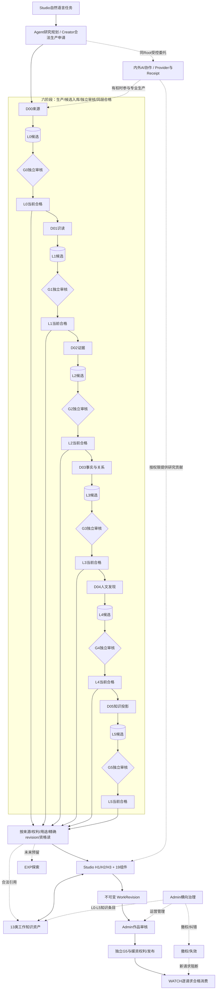

# 墨痕 M5 全链路导航｜持续维护基线（非权威标准）

> 源码核对基线：`xiezuojie03-web/mohen-agent-2.0@2c4db01783ccdb24d21f1fc99e1b28abca82d3fc`；核查日期 2026-11-15。唯一施工与准出标准仍为 `tasks/implementation/MAB/PLAN.md` V1.7 §3.5 B/C。每次施工必须先回读 `CURRENT.md` 与最新 main、CI/实际运行证据。
>
> **角色：** 本图为后续任务的“指南针”，可以在阶段性定向收口后持续生长。不是系统已跑通的证明，不构成第二套架构权威、Runner、Gate、知识库或M5验收标准。三份导航（JSON/MD/HTML）必须同步更新。

## 正式三层状态模型（2026-11-15）

**三个独立符号**：`◆能力 capability`核实功能代码、持久数据和专业方法是否具备；`⇄连接 handoff`核实上下游真实输入输出、身份、用途、权限、精确版本与独立Gate资格能否合法衔接；`●运行 runtime`核实同一真实Root Task的正反、持久、恢复及消费证据。任何一层通过都不能推导另一层通过。

**五状态**：`PASS 绿色`=有该层有效完整证据；`PARTIAL 蓝色`=有明确局部实现、尚未完整验证；`HOLD 橙色`=有可定位的明确阻断或合法条件不满足；`NOT_VERIFIED 灰色`=证据不足，既不算成功也不判缺代码；`FUTURE 紫色`=未来预留，非当前M5缺口。注意**状态和断点根因不同**：根因沿用既有 `engineering_diagnosis`。

**唯一机器状态入口**：每个 `nodes[]`、`edges[]` 的 `verification_layers.capability / handoff / runtime`，每层含 `status、reason、evidence_refs[]、verified_source_sha、observed_on`。先阅读顶层 `layer_status_model`。旧 `status` 仅保留历史兼容，不用于判断能力或施工完成率。三份导航的内容来自同一JSON；后续按证据原位同步更新，绝不能自动填PASS。

**当前有界证据**：此前7条连接有定向源码归因，其中G0签发/资格2条、D01→D02适配1条、D00通用业务范围1条均为◆PARTIAL/⇄HOLD/●NOT_VERIFIED；另3条局部代码路径为◆PARTIAL/⇄PARTIAL/●NOT_VERIFIED。其余45条当前范围连接三层均NOT_VERIFIED，另2条EXP预留为FUTURE。此前确认30个源码定位路径存在不能替代45条逐边核查。**本次没有任何运行PASS。**

| 连接例子 | ◆能力 | ⇄连接 | ●运行 | 下一步 |
|---|---|---|---|---|
| G0→L0当前资格 | PARTIAL | HOLD：签发回执缺精确stage_binding | NOT_VERIFIED | 修复独立签发合同，真实同Root正反实证 |
| 合格L1→D02 | PARTIAL | HOLD：缺D02 typed请求转换 | NOT_VERIFIED | 复用两端已有代码补受控交接 |
| D01→L1候选 | PARTIAL | PARTIAL：局部实现 | NOT_VERIFIED | 继承局部CI/隔离测试再做真实Root |
| 未逐接口核查 | NOT_VERIFIED | NOT_VERIFIED | NOT_VERIFIED | 按实际施工节点定向核查 |
| EXP未来边 | FUTURE | FUTURE | FUTURE | 不计M5，后续批准后激活 |

**交互导航**：顶部“总体/◆能力/⇄连接/●运行”切换；主图各节点显示三枚独立彩色状态符号；54条边的搜索台账按选择层和五状态筛选。点击节点或连接，查看各层原因/精确源码/证据/下一动作。颜色计数不能冒充工程完成率。

**持续施工**：最新main/CI → CURRENT → PLAN §3.5 B/C唯一八维 → JSON三层状态/根因 → 定位最前业务HOLD → 只修能力或连接或补实证 → 精确SHA/环境/Root/POS-NEG与恢复证据入progress → 更新CURRENT及同提交三份导航。三层只负责定位，**不新增验收体系**。

## 本轮已核的断点类型（持续更新，不是完成率）

当前54条连接中，2条确认签发/资格接口不匹配、1条确认受控跨阶段转换缺失、1条确认通用业务范围缺口、3条已有局部实现但缺同Root实证、45条**只定位到关联源码但尚未逐接口归因**、2条未来预留。**这些分类不是工程完成率，更不是缺代码比率。**30条唯一边级源码定位文件均能在本次固定SHA找到，但文件存在不等于边能运行。

| 当前先核边 | 分类 | 证据与下一工作 |
|---|---|---|
| `E_D00_REVIEW` / `E_D00_QUALIFY` | 签发与消费合同不匹配 | `rule-gate-reviewer.mjs` 的签发receipt缺 `stage_binding`；读取器 `auditHasExactStageBinding` 要求stage/job/reviewer/input/output同源。不能用旧G0局部PASS冒充。 |
| `E_L1_TO_D02` | 缺中间受控转换 | D01 reading candidate存在，D02 H05持久化路径存在，但需从独立签G1的L1读取候选形成D02 typed request；Runner现正确HOLD。 |
| `E01` | 通用D00范围缺口 | 已有私有原件路径不等于自然语言选题到所有合法外部来源的发现、取得、权利及G0全部贯通。 |
| `E_D00_WRITE` / `E_L0_TO_D01` / `E_D01_WRITE` | 有局部实现但缺同Root实证 | 沿用已成功的CI/隔离PG/HTTP回执，但须同一真实Root、原件、Reviewer、资格正反及持久恢复实跑。 |

**后续全面核查，不等于每次全仓扫描。** 先冻结本图M5相关节点/边的覆盖范围，按真实Root逐批核主干相邻连接及必需支管；每批留存“有代码/无代码/接口不匹配/环境或权限未就绪/实证通过”的具体理由、精确SHA与POS/NEG证据；最后审计所有M5相关边是否都有核查结论。EXP两条未来边不纳入M5通过分母；M5准出仍由PLAN八维决定。

## 一、M5主链与横向能力

> 线条表达职责与可消费关系，不把每条关系视为代码已贯通。候选与合格是同层不同资格状态；失效保留历史；Admin不替代G0—G5。

## 二、阶段真实工程定位（精确SHA的部分代码事实，非整链PASS）

| 阶段 | 本次导航状态 | 实际已知阻断 |
|---|---|---|
| D00 / L0 / G0 | partial | Studio 当前仍要求已登记私有原件；独立Reviewer精确签发尚未由同一真实Run验证 |
| D01 / L1 / G1 | partial | G1精确审签与D01→D02专业请求生成未连通 |
| D02 / L2 / G2 | blocked | PRIVATE_NEXT_STAGE_REQUEST_NOT_READY；需要从合格L1组织真实观察输入 |
| D03 / L3 / G3 | blocked | 缺以合格L2证据生成D03类型请求及独立G3整链实证 |
| D04 / L4 / G4 | blocked | 缺合格L3事实到人文解释的类型化与专业审签交接 |
| D05 / L5 / G5 | blocked | L4→D05专业转换、精确G5和多消费者资格未接通 |

**最前断点：** 独立G0审签须有精确stage_binding与同源输出digest的合法Reviewer证据；紧接着是已签G1读取单元→D02 H05专业观察typed请求生成。已有D00→D01代码和D02确定性HOLD不能算同一真实作品的PG/HTTP/Provider全链PASS。

**证据等级说明：** 核对了原导航引用的26条唯一代码路径均在固定源码SHA下存在，并针对Runner、Worker、Gate与Studio及13类资产/19组件合同回读关键片段；但未完成全仓每个调用者/运行路径与每条边的独立实跑。边的 `source_paths` 是**待核实的源码入口**，不是“接口已经接通”的证书。任何运行条件未实证记NOT_RUN/HOLD。

## 三、M5唯一八维验收与节点/连接索引

- **1. 自然语言创作入口**：Studio真实问题→Brief/Plan，资料可得性与可继续状态。关联节点 `AGENT_PLAN`，关联连接 2 条；导航不判定PASS。
- **2. 内外AI混合协作**：同root下Agent/外部Provider真实贡献、权利、预算、Receipt与恢复。关联节点 `AGENT_PLAN、MIXED_COLLABORATION`，关联连接 3 条；导航不判定PASS。
- **3. 真实来源、证据和D/L/G生产**：合法原件→D00-D05/L0-L5/G0-G5精确资格与整链消费。关联节点 `QUALIFIED_CONSUMPTION`，关联连接 32 条；导航不判定PASS。
- **4. 13类知识资产沉淀**：13类型级正反合同，真实作品只产生实际适用类型。关联节点 `QUALIFIED_CONSUMPTION、KNOWLEDGE_ASSETS`，关联连接 4 条；导航不判定PASS。
- **5. Studio真实创作**：H1/H2/H3与19组件真实职责、预览编辑、WorkRevision。关联节点 `QUALIFIED_CONSUMPTION、STUDIO_CREATIVE`，关联连接 12 条；导航不判定PASS。
- **6. Admin知识资产管理**：逐条精确修订、来源权利资格与使用史、撤回管理。关联节点 `ADMIN、KNOWLEDGE_ASSETS`，关联连接 9 条；导航不判定PASS。
- **7. 独立G5、媒资权利与发布**：Reviewer分权、WorkRevision及媒体逐动作许可、原子指针。关联节点 `PUBLISH`，关联连接 3 条；导航不判定PASS。
- **8. WATCH同修订合法消费与撤权**：每次资格检查、立即阻断新请求、缓存及原件保护。关联节点 `WATCH、REVOKE`，关联连接 3 条；导航不判定PASS。

13类 `asset_kind`（来自正式资产合同）：`research_brief / source_anchor / reading_note / evidence_note / spacetime_candidate / relation_hypothesis / humanistic_insight / research_collection / director_plan / media_selection / work_revision / citation_snapshot / consented_feedback`。这13类并非13个新数据库，且真实作品不应为凑数制造不适用的资产；类型合同与业务正反测试仍是不同责任。

## 四、机器接续与持续维护纪律

1. **必读入口：** 核实最新main与CI → 读 `CURRENT.md` → 读 `tasks/implementation/MAB/PLAN.md` §3.5 B/C → 读本目录JSON的 `navigation_policy`、`acceptance_dimensions`、`nodes[]`、`edges[]` → 必要时看本MD及交互HTML。
2. **实际核查：** 从同一真实Creator/Project/Root Task选最前HOLD连接，核上游真实输出、下游typed输入、准确代码、持久revision、当前Gate审签与权利/用途、负例、恢复与同Root证据。已验证未变化直接继承，不重复全仓盘点；证据不足标 `NOT_RUN/HOLD`。
3. **原位更新：** 工程实况变化时对受影响节点/连接定向复核；JSON记录事实与证据等级，MD解释，HTML展示。三份同一提交同步且HTML内嵌JSON与独立JSON完全一致。更新 `CURRENT.md`（当前事实），`progress.md`（实际证据）；不在导航里创设新标准。
4. **准出判断：** 只用 `PLAN.md` §3.5 B八维同一真实作品正反验收；WATCH属于M5当前目标，EXP未来预留。生产部署仍需独立授权。

**直接机器入口：** `tasks/results/MAB/M5_MAINLINE_NAVIGATION_20261115.json`；可视化入口：`tasks/results/MAB/M5_MAINLINE_NAVIGATION_20261115.html`。本导航在阶段性收口后继续服务M5施工及随后合法扩展，不能因收口而停更。
