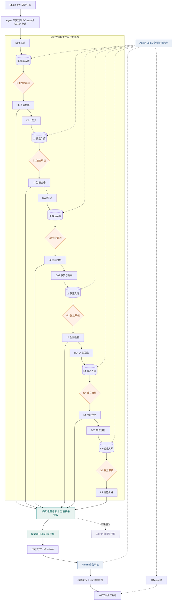

# 墨痕 M5 全链路导航图（工作稿｜非权威标准）

> 精确源码基线：`xiezuojie03-web/mohen-agent-2.0@2c4db01783ccdb24d21f1fc99e1b28abca82d3fc`，核查日期 2026-11-15。唯一权威仍为 `tasks/implementation/MAB/PLAN.md` V1.7 §3.5 B/C。  
> **用途：** 人类可视化 + Agent 机器化索引 + 输入/执行/输出/消费/资格断点定位。不能以本图替代真实代码与回归证据，也不是第二套M5准出标准。

## 一、完整链路

## 二、必须保持的语义

1. 每层是 `Dxx生产 → Lx保存候选及证据 → Gx独立签发 → 同一Lx的合格资格视图`。未通过者保留候选与审核历史，但不得当成合格资产被调用。
2. Studio `H1/H2/H3` **可按需访问 L0—L5 六层**，不是只能访问L5。对原件书影/引文/图像的展现、对模型外发等均逐用途核对权利、Gate当前资格、精确revision和撤权。
3. Admin横向覆盖 L0—L5 的候选、审核、版本、来源、权利、使用历史、纠错及失效；它有管理权但不代替独立G0—G5签发。另承担作品审核、发布运营与撤回。
4. D00发现候选来源不应因当前读取方法局限而人为收窄；资源发现≠取得授权≠用途授权。当前Studio对已有私有原件和 C01/C02 的依赖是工程断点，而不是D00的长期边界。
5. 自然语言触发Agent研究规划；新生产触发须Creator按ST-04明确请求。已合格知识可直接合法复用，不必每次强制从D00重生产。
6. WATCH是M5当前目标；EXP暂为未来预留连接，不能算已实现。

## 三、沿主干可追踪的真实工程状态（按精确main源码）

| 位置 | 已有能力/修复 | 剩余断点 | 核心源码 |
|---|---|---|---|
| D00 / L0 / G0 | 来源候选的持久化已有代码；通用外部资源获取到Studio的连接与真实G0签发待闭环 | **Studio 当前仍要求已登记私有原件；独立Reviewer精确签发尚未由同一真实Run验证** | `pipelines/data-production/workers/private-evidence-stage.mjs` |
| D01 / L1 / G1 | C01文本真实字节读取与Studio授权读回已修；C02专业OCR、完整G1资格仍待实证 | **G1精确审签与D01→D02专业请求生成未连通** | `pipelines/data-production/workers/private-evidence-stage.mjs` |
| D02 / L2 / G2 | 旧D02专业内容生成与新H05候选持久化都存在，但尚未受控连接 | **PRIVATE_NEXT_STAGE_REQUEST_NOT_READY；需要从合格L1组织真实观察输入** | `pipelines/data-production/adapters/layer1-adapters.mjs` |
| D03 / L3 / G3 | 旧D03专业推理与新claim候选持久化存在，真实G2→D03接力未证实 | **缺以合格L2证据生成D03类型请求及独立G3整链实证** | `pipelines/data-production/adapters/layer1-adapters.mjs` |
| D04 / L4 / G4 | 旧D04专业提示词与新finding候选Worker存在，L3→D04接力未完成 | **缺合格L3事实到人文解释的类型化与专业审签交接** | `pipelines/data-production/adapters/layer1-adapters.mjs` |
| D05 / L5 / G5 | 旧D05投影与新world_projection候选已有实现，G5跨用户用途消费尚未整链实证 | **L4→D05专业转换、精确G5和多消费者资格未接通** | `pipelines/data-production/adapters/layer1-adapters.mjs` |
| 六层 → Studio | Owner受权阅读与L5读模型分别有实现 | L0—L5对同一作品的按用途合格读取和使用事件未整链验收 | `apps/web/lib/studio-research-read.ts` |
| Admin 全层 | 图片台账、投稿审核、部分撤权及来源/资产API存在 | 没有证据表明全六层同一知识对象的治理体验已完成 | `apps/web/lib/admin-assets.ts` |
| WorkRevision → 发布 → WATCH | 编辑、投稿、独立G5消费核验、部分WATCH代码存在 | 同一WorkRevision跨发布/撤权整链未真实验收 | `apps/web/lib/publication.ts` |

## 四、供 AI 执行核查的顺序（非新计划）

读取同目录的 `墨痕_M5_全链路导航_机器可读.json`。对 `edges[]` 中每条边，依次核 `source` 实际输出、`target` 预期输入、执行代码、持久输出/精确revision、权限与独立资格、下游消费、负例及恢复；任何证据缺失记 `NOT_RUN` 或 `HOLD`，不得根据此图标记PASS。仅修当前最前断点，并复用 `code_paths` 指向的旧新实现。完整准出继续按 PLAN V1.7 M5 八维。

**备注：** 本图“合格资格视图”是同层资格的概念表达，**并非新增L层数据库或第二套Runner/Gate/Truth**。